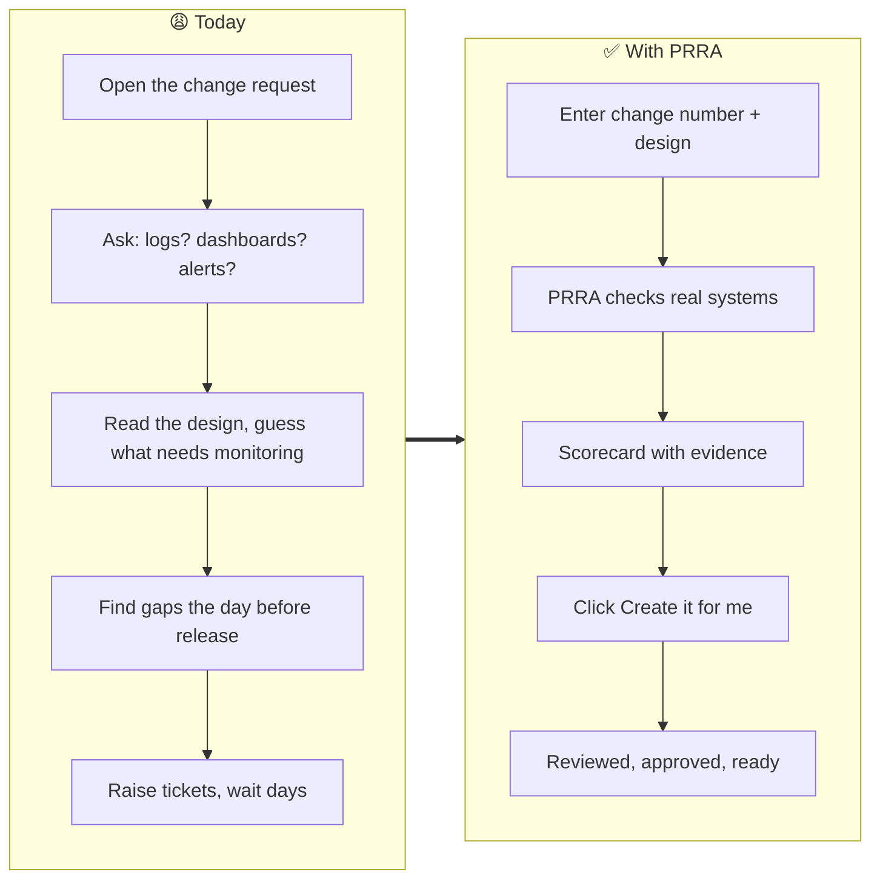
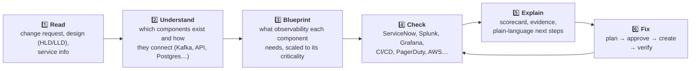
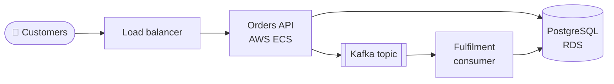
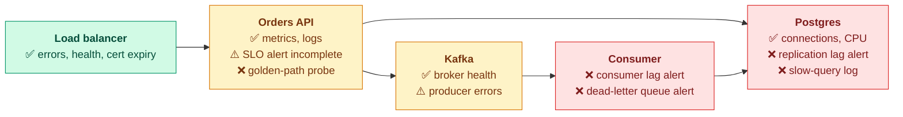
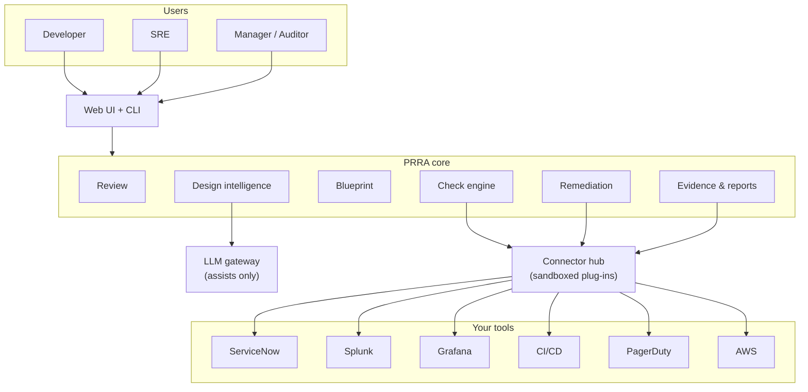
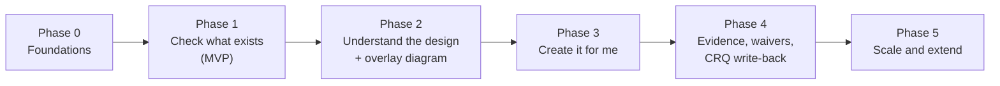

<p align="center">
  
</p>

<p align="center">
  
  
  
</p>

> **PRRA turns the slow, manual "are we ready for production?" conversation into a fast, evidence-based review, and can fix many of the gaps it finds.**

---

## The 30-second story

Before a pilot takes off, they run a **pre-flight checklist**: fuel, instruments, controls. They don't trust memory, and many airports can top up the fuel on the spot.

Software going live needs the same thing. Before a release reaches customers, someone (usually an **SRE**) must be sure that:

- the **change request** is complete (what's changing, how to undo it, who approved),
- the team can **see** what the system is doing (logs, metrics, dashboards, alerts),
- the **right person gets woken up** if it breaks,
- the **pipeline** and **safety nets** (backups, failover) are in place.

Today that is a pile of tabs, screenshots and tribal knowledge. **PRRA does the checking, shows the evidence, explains every gap in plain language, and, with approval, creates what's missing.**



---

## How it works



## ⭐ The signature feature: the "second diagram"

Give PRRA a design. It draws **what you built**, then **what you need to be able to see**, component by component, with live status.

**Diagram 1: the design** *(what the developer provides)*



**Diagram 2: the observability overlay** *(what PRRA adds)*



✅ in place · ⚠️ partly there · ❌ missing · ⏳ not yet checked. Click a component to see **why** it matters, **how to get it**, and a **Create it for me** button for the red ones. Full worked example: [Observability Blueprint §7](docs/04-observability-blueprint.md#7-worked-example-orders-api).

---

## What you get

| For the **developer** | For the **SRE** | For **managers & auditors** |
|---|---|---|
| Know *today* exactly what's missing | One scorecard instead of six tools | Readiness trends by team and tier |
| Plain-language "why" for every gap | Evidence behind every result | Immutable evidence packs |
| **Create it for me** for dashboards, alerts, on-call, tasks | Approve plans with a clear diff | Waivers with owner and expiry |
| Fix gaps early, not the night before | Consistent standards across reviewers | Results written back to the change request |

### Capabilities

| | |
|---|---|
| 🧾 **Change request checks** | Backout plan, tasks, approvals, risk, windows, test evidence (ServiceNow first) |
| 👁️ **Observability checks** | Logs, metrics, traces, alerts, dashboards, SLOs, runbooks, synthetic probes |
| 🧩 **Design intelligence** | Reads HLD/LLD, builds a component graph with citations; a human confirms |
| 📐 **Tier-aware blueprints** | Critical (T0) services need more than standard (T3) ones |
| 🔌 **Extensible** | Connector SDK: ServiceNow today, Jira tomorrow; add your own checks, no fork |
| 🛠️ **Remediation** | Plan → approve → apply → verify; as-code pull requests preferred |
| 🔐 **Trustworthy by design** | Read-only by default, AI never decides, unknown ≠ pass, full audit |

---

## Architecture at a glance



Deep dive: [HLD](docs/03-architecture/hld.md) · [LLD](docs/03-architecture/lld.md) · [Deployment](docs/03-architecture/deployment.md) · [Decisions (ADRs)](docs/adr/README.md)

## Design principles

1. **Evidence over attestation.** Results come from real systems, with the proof stored.
2. **AI assists; checks decide.** AI reads messy documents and explains; it never passes or fails a release ([ADR-0004](docs/adr/0004-ai-assists-checks-decide.md)).
3. **Unknown is not pass.** If PRRA can't check, it says so and still blocks "Ready".
4. **Safe by default.** Read-only first; every write has a plan, an approval and an audit trail.
5. **Extensible, not forkable.** Connectors, checks and patterns are plug-ins.
6. **A gate must never be a single point of failure.** There is always a manual fallback.

---

## Documentation map

| # | Document | What's inside | Best for |
|---|---|---|---|
| 00 | [Glossary](docs/00-glossary.md) | Every term in plain English | Everyone |
| 01 | [Vision & product brief](docs/01-vision-and-product-brief.md) | Problem, goals, personas, scope | Everyone |
| 02 | [Requirements](docs/02-requirements.md) | Epics, FR/NFR, user stories, acceptance criteria | Product, QA |
| 03 | [High-Level Design](docs/03-architecture/hld.md) | Context, containers, key flows, risks | Architects, engineers |
| 03 | [Low-Level Design](docs/03-architecture/lld.md) | Data model, state machine, check engine, APIs | Engineers |
| 03 | [Deployment & Operations](docs/03-architecture/deployment.md) | Kubernetes topology, CI/CD, DR, SLOs | Platform, SRE |
| 04 | [**Observability Blueprint**](docs/04-observability-blueprint.md) | Tiers, pattern library, the "second diagram" | **SRE, everyone** |
| 05 | [Checks catalog](docs/05-checks-catalog.md) | 68 initial checks by category | SRE, QA |
| 06 | [Connector & check SDK](docs/06-connector-sdk.md) | How to integrate any tool | Integrators |
| 07 | [Security & compliance](docs/07-security-and-compliance.md) | Threat model, RBAC, LLM data handling | Security, auditors |
| 08 | [Roadmap & team plan](docs/08-roadmap.md) | Phases, team roles, success measures | Product, leadership |
| 09 | [UX & journeys](docs/09-ux-and-journeys.md) | Journeys, screens, wireframes | Design, product |
| – | [ADRs](docs/adr/README.md) | Why we chose what we chose | Architects |

> **Suggested reading paths**
> *Non-technical:* this page → [Glossary](docs/00-glossary.md) → [Vision](docs/01-vision-and-product-brief.md) → [UX & journeys](docs/09-ux-and-journeys.md).
> *SRE:* [Blueprint](docs/04-observability-blueprint.md) → [Checks](docs/05-checks-catalog.md) → [Security](docs/07-security-and-compliance.md).
> *Engineer:* [HLD](docs/03-architecture/hld.md) → [LLD](docs/03-architecture/lld.md) → [SDK](docs/06-connector-sdk.md) → [ADRs](docs/adr/README.md).

## Roadmap



Details, estimates and exit criteria: [Roadmap](docs/08-roadmap.md). Work is tracked in [GitHub Issues](../../issues) by epic and milestone.

## Project status

**Phase 0 (Foundations) is under way.** The design is approved and merged; the first code is a backend skeleton: a FastAPI **modular monolith** whose module boundaries are enforced by tests ([ADR-0002](docs/adr/0002-modular-monolith-first.md)), OpenTelemetry from day one, CI, and a local dev stack. No product features yet. Progress is tracked in [GitHub Issues](../../issues) by milestone.

### Run it locally

```bash
make install   # backend dependencies (needs uv)
make test      # unit + architecture tests
make run       # API on http://localhost:8000  (docs at /docs)
make check     # lint, types, tests, docs links
# or the full local stack (API + Postgres + OpenTelemetry collector):
docker compose up --build
```

## Contributing

See [CONTRIBUTING.md](CONTRIBUTING.md). New ideas for checks, patterns or connectors are especially welcome; use the issue templates.

## License

[Apache License 2.0](LICENSE)
