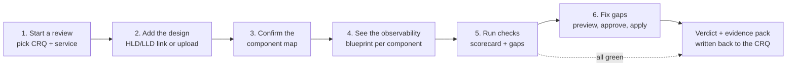

# 01 · Vision & Product Brief

> **One line:** PRRA turns the slow, manual, tribal-knowledge "are we ready for production?" conversation into a fast, evidence-based, largely automated review, and can fix many of the gaps it finds.

---

## 1. The problem

Every team shipping to production eventually meets the same wall: the **Production Readiness Review (PRR)**.

A developer says *"we're ready to go live."* An SRE (Site Reliability Engineer) has to verify that claim. Today that looks like this:

| What happens today | Why it hurts |
|---|---|
| The SRE opens the change request (CRQ) in ServiceNow and reads it field by field | Slow, easy to miss things, inconsistent between reviewers |
| They ask: "Do you have logs in Splunk? Dashboards? Alerts? On-call?" | Answers are verbal or screenshots, not evidence |
| They ask the developer for the design (HLD/LLD) and mentally work out what needs monitoring | Depends on the reviewer's experience; Kafka, API and database each need different signals |
| Gaps are found **late**, often the day before the release | Releases slip, or ship with blind spots |
| Fixing gaps means raising more tickets to more teams | Days of back-and-forth |
| Nothing is recorded in a reusable form | Same mistakes repeat on the next release |

**The result:** inconsistent reviews, delayed releases, and production incidents that "we couldn't see coming because nothing was watching".

## 2. The idea

**PRRA (Production Readiness Review Assistant)** is an automation + AI-assisted tool that:

1. **Reads** the release context (the CRQ, the HLD/LLD, the service catalogue entry).
2. **Understands** the design: which components exist (Kafka, an API on AWS, Postgres, ...) and how they connect.
3. **Generates an observability blueprint**: for *each* component, exactly which logs, metrics, traces, alerts, dashboards, SLOs and runbooks are needed, scaled to the service's **availability tier**.
4. **Checks reality** against that blueprint by calling the real systems (ServiceNow, Splunk, Grafana/Datadog, CI/CD, PagerDuty, AWS, ...).
5. **Scores** the readiness and explains every gap in plain language, with evidence.
6. **Fixes** gaps on request ("Create it for me" button): generates dashboards, alerts, log searches, on-call routing and tasks, shows a plan, and applies it after approval.
7. **Records** everything as an auditable evidence pack and writes the result back to the CRQ.

> **Analogy for non-technical readers:** PRRA is the *pre-flight checklist* for software. A pilot doesn't rely on memory before takeoff; a checklist verifies fuel, instruments, and controls, and many airports can top up the fuel on the spot. PRRA does the same for software going live: it verifies the "instruments" (monitoring), the "paperwork" (change request) and the "crew" (on-call), and can fix what's missing.

## 3. Goals and non-goals

### Goals
- **G1** Cut the time of a readiness review from days to **hours** (target: median < 4 working hours for a standard service).
- **G2** Make reviews **consistent and evidence-based** regardless of who the reviewer is.
- **G3** Shift gaps **left**: surface them when the design is approved, not the day before release.
- **G4** Make observability **a by-product of design**: derive the needs from the HLD/LLD automatically.
- **G5** Offer **one-click remediation** for common gaps (with preview, approval and audit).
- **G6** Be **extensible**: new tools (ServiceNow today, Jira tomorrow), new component types and new organisation-specific checks without forking the core.
- **G7** Be understandable by non-engineers: clear status, clear "why", clear next step.

### Non-goals (for now)
- **NG1** PRRA is **not** a deployment tool. It does not release software; it *advises and gates*.
- **NG2** PRRA does **not** replace human judgement. The AI never decides pass/fail (see [ADR-0004](adr/0004-ai-assists-checks-decide.md)).
- **NG3** PRRA is **not** a monitoring platform. It configures and verifies the tools you already use.
- **NG4** Not a full CMDB or service catalogue; it integrates with the ones you have.
- **NG5** Not a penetration-testing or full security-scanning tool (it verifies that those scans *happened* and passed).

## 4. Personas

| Persona | Role | Wants | Pain today |
|---|---|---|---|
| **Dana**, Developer | Owns the feature going live | Know *early* and *exactly* what's missing; fix quickly | Surprise findings the day before release; unclear expectations |
| **Sam**, SRE Reviewer | Approves production readiness | A trustworthy scorecard with evidence; focus on judgement, not data gathering | Manual checking in six tools; inconsistent standards |
| **Chris**, Change Manager | Owns the CRQ process | Complete, compliant CRQs; audit trail | Incomplete CRQs; chasing people |
| **Morgan**, Engineering/Service Owner | Accountable for reliability | Fleet-wide view of readiness and risk; trends | No visibility; surprises in incidents |
| **Alex**, Platform Admin | Runs PRRA and integrations | Safe connectors, SSO/RBAC, easy extension | Tool sprawl; security of credentials |
| **Riley**, Security/Compliance | Needs evidence for audits | Immutable evidence and waiver trail | Screenshots in emails |

## 5. Value and success measures

These are **hypotheses to validate** in the pilot, not guarantees.

| Metric | Baseline (assumed) | Target |
|---|---|---|
| Median review lead time | 2-5 days | < 4 working hours |
| % of reviews with a gap found < 24 h before release | high / unknown | < 10 % |
| CRQ first-time-complete rate | ~50 % | > 90 % |
| Services with all tier-required alerts + dashboards at go-live | ~60 % | > 95 % |
| Production incidents tagged "no monitoring / no alert" | tracked manually | -50 % within 2 quarters |
| Reviewer satisfaction (survey) | n/a | ≥ 4 / 5 |

## 6. The product in six screens (conceptual)

## 7. Guiding principles

1. **Evidence over opinion.** Every pass/fail links to proof (an API response, a query result, a document).
2. **Deterministic gates, AI assistance.** Checks are code/rules. AI reads documents, explains and drafts, but never silently decides.
3. **Read-only by default.** Write access exists only for approved remediation.
4. **Explainable to anyone.** Each finding says *what*, *why it matters*, *how to fix*, *who owns it*.
5. **Extensible by design.** Connectors, checks and component patterns are plug-ins.
6. **Tier-aware.** A hobby tool and a payment platform do not need the same rigour; the availability tier sets the bar.
7. **Dogfood.** PRRA must itself pass a PRR.

## 8. Assumptions and open questions

| # | Assumption / question | Owner | Status |
|---|---|---|---|
| A1 | Organisation uses ServiceNow for change management | Chris | assumed (extensible to others) |
| A2 | Logs in Splunk; metrics/dashboards in Grafana/Datadog/CloudWatch | Sam | assumed, confirm per org |
| A3 | HLD/LLD exist as Confluence/Markdown/PDF/diagrams | Dana | to validate; diagram-as-code preferred |
| Q1 | Is there a single service catalogue / CMDB to key everything on? | Alex | open |
| Q2 | Which availability-tier definitions does the org use? | Morgan | open (a default is provided, see [Observability Blueprint](04-observability-blueprint.md)) |
| Q3 | Can remediation write to production monitoring tools, or only to non-prod first? | Riley | open (design supports both) |
| Q4 | Hosting: SaaS, self-hosted, or both? | Alex | open (design is self-hostable) |
