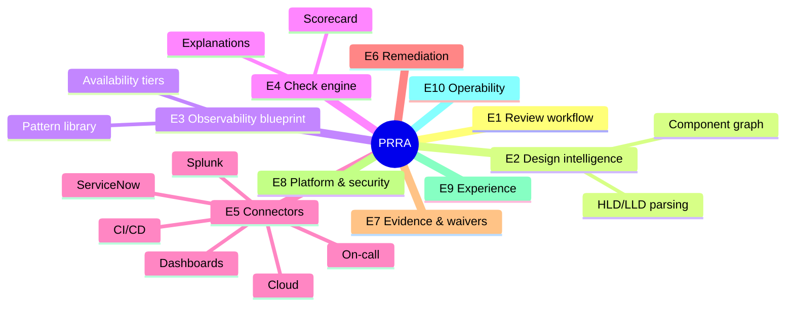
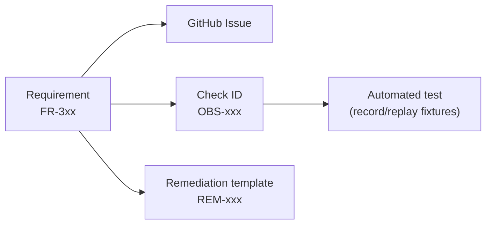

# 02 · Requirements

The original ask was deliberately broad. This document turns it into **structured, traceable requirements**. IDs (`FR-`, `NFR-`) are referenced by GitHub issues, checks and tests.

Priority uses **MoSCoW**: **M**ust / **S**hould / **C**ould / **W**on't (yet).

---

## 1. Epics at a glance

| Epic | Name | Outcome |
|---|---|---|
| **E1** | Review workflow | A review can be created from a CRQ, progressed, and closed with a verdict |
| **E2** | Design intelligence | HLD/LLD becomes a confirmed **component graph** |
| **E3** | Observability blueprint | Per-component, tier-aware list of required observability |
| **E4** | Check engine & scorecard | Deterministic checks run against real systems, scored and explained |
| **E5** | Connectors & extensibility | ServiceNow, Splunk, dashboards, CI/CD, on-call, cloud, plus an SDK |
| **E6** | Remediation | "Create it for me": plan → approve → apply → verify |
| **E7** | Evidence, reporting & waivers | Immutable evidence pack, CRQ write-back, waivers |
| **E8** | Platform & security | SSO, RBAC, audit, multi-tenancy, secrets |
| **E9** | Experience | Clear UI for developers, SREs, and non-technical stakeholders |
| **E10** | Operability & delivery | PRRA is itself production-ready; CI/CD; docs |

---

## 2. Functional requirements

### E1 · Review workflow

| ID | Requirement | Pri |
|---|---|---|
| FR-101 | Create a **Review** for a *service* + *release* (optionally linked to a CRQ number) | M |
| FR-102 | A review moves through a defined lifecycle (see [LLD §4](03-architecture/lld.md#4-review-lifecycle-state-machine)) | M |
| FR-103 | Assign roles per review: requester, SRE reviewer, approver, observers | M |
| FR-104 | Re-run checks at any time; keep history of every run | M |
| FR-105 | Final verdict: **Ready**, **Ready with conditions**, **Not ready** with rationale | M |
| FR-106 | Verdict is *recommended* by PRRA, *decided* by a human reviewer | M |
| FR-107 | Template reviews for recurring release types (standard, emergency, hotfix) with different check sets | S |
| FR-108 | Notifications (email/Slack/Teams) on state change, new blocking finding, approaching release window | S |
| FR-109 | Clone a previous review as a starting point | C |

### E2 · Design intelligence

| ID | Requirement | Pri |
|---|---|---|
| FR-201 | Ingest design from: Markdown, Confluence page, PDF, uploaded diagram image, Mermaid / PlantUML / draw.io / Structurizr DSL, OpenAPI | M (Markdown, Mermaid, Confluence first) |
| FR-202 | Extract a **component graph**: nodes (type, name, tech, hosting) and edges (protocol, direction, sync/async) | M |
| FR-203 | Show extraction **with confidence + source citation** (which sentence/box produced it) | M |
| FR-204 | Human can **edit, add, remove** components and confirm the graph before it is used | M |
| FR-205 | Capture **availability design**: tier, multi-AZ/region, RTO/RPO, SLO targets, failover mode | M |
| FR-206 | Detect design inconsistencies (e.g., "API says 99.99 % but depends on a single-AZ database") | S |
| FR-207 | Support structured input (YAML "service manifest") for teams that prefer it over documents | M |
| FR-208 | Version designs; diff between versions | S |
| FR-209 | Pull component inventory from cloud/Kubernetes to **cross-check** the design against what's actually deployed | C |

### E3 · Observability blueprint

| ID | Requirement | Pri |
|---|---|---|
| FR-301 | Maintain a **Pattern Library**: for each component *type*, the required logs, metrics, traces, alerts, dashboards, SLOs, runbooks, synthetic checks | M |
| FR-302 | Generate a **blueprint** for a confirmed graph: per component, per signal type, with *why* and *how to obtain* | M |
| FR-303 | **Tier-aware**: requirements scale with availability tier (see [Blueprint §3](04-observability-blueprint.md#3-availability-tiers)) | M |
| FR-304 | Render the blueprint as a **diagram overlay** below the design diagram (the "second diagram" in the original ask) | M |
| FR-305 | Include **cross-component** requirements: end-to-end trace, correlation IDs, dependency maps, golden-path synthetic check | M |
| FR-306 | Patterns are **versioned, overridable per org/team**, and installable as packs | M |
| FR-307 | Each blueprint item maps to one or more **checks** (so it can be verified) and one or more **remediation templates** (so it can be created) | M |
| FR-308 | Export blueprint as Markdown/PDF/JSON | S |

### E4 · Check engine & scorecard

| ID | Requirement | Pri |
|---|---|---|
| FR-401 | Checks are **declarative** (YAML + query/rule), versioned, testable, tagged with category/severity/tier | M |
| FR-402 | Check categories: **CRQ**, **Observability**, **Pipeline**, **Operations**, **Resilience**, **Security**, **Dependencies** (see [Catalog](05-checks-catalog.md)) | M |
| FR-403 | Each check result has: status (`pass/fail/warn/skip/error`), severity, evidence, explanation, owner, fix hint | M |
| FR-404 | **Severity** model: Blocker / Major / Minor / Info; Blockers prevent a "Ready" recommendation | M |
| FR-405 | Scorecard per category and overall; plain-language summary | M |
| FR-406 | Distinguish **"failed"** from **"couldn't check"** (connector down, no permission) | M |
| FR-407 | Checks run in parallel with timeouts, retries, rate-limit awareness | M |
| FR-408 | Dry-run / "what-if": evaluate a design's blueprint before anything is built (design-time readiness) | S |
| FR-409 | Org-specific checks can be added via config (no code) or SDK (code) | M |
| FR-410 | Continuous re-evaluation after go-live (drift detection) | W (Phase 5) |

### E5 · Connectors & extensibility

| ID | Requirement | Pri |
|---|---|---|
| FR-501 | **Connector SDK** with capability interfaces (ChangeManagement, Logs, Metrics, Dashboards, Alerting, CI/CD, OnCall, Cloud, Catalog, Docs) | M |
| FR-502 | First-party connectors (MVP): **ServiceNow**, **Splunk**, **Grafana**, **GitHub Actions**, **PagerDuty**, **AWS** (read) | M |
| FR-503 | Next connectors: Datadog, CloudWatch, Prometheus/Alertmanager, Jenkins, ArgoCD, Opsgenie, Jira, Confluence, Kubernetes, Azure/GCP | S |
| FR-504 | Connector **manifest** declares capabilities, required scopes, config schema, rate limits | M |
| FR-505 | Connectors run **sandboxed** (separate process/container, egress allow-list) | M |
| FR-506 | Connector **health + test-connection** UI | M |
| FR-507 | Mock/record-replay connectors for tests and demos | M |
| FR-508 | Third-party packs (checks + patterns + connectors) installable and signed | C |

### E6 · Remediation

| ID | Requirement | Pri |
|---|---|---|
| FR-601 | For failing items with a remediation template, offer **"Create it for me"** | M |
| FR-602 | Always produce a **plan** first: exact objects to create/change, target system, diff, risk | M |
| FR-603 | **Approval gate** (configurable: requester, SRE, or both) before any write | M |
| FR-604 | Apply via **idempotent** actions; record outcomes; support **rollback** where possible | M |
| FR-605 | **Verify** after apply: re-run the originating check and show result | M |
| FR-606 | Remediation types (MVP): Grafana dashboard, Splunk saved search/alert, PagerDuty service + escalation, ServiceNow tasks on CRQ, alert rules | M |
| FR-607 | Prefer **as-code outputs** (Terraform/Jsonnet/YAML) → raise a **PR to the team's repo** instead of changing tools directly (configurable) | S |
| FR-608 | Target **non-prod first** option; promotion workflow | S |
| FR-609 | Bulk remediation ("fix all safe gaps") with per-item opt-out | C |

### E7 · Evidence, reporting & waivers

| ID | Requirement | Pri |
|---|---|---|
| FR-701 | Every check stores **evidence** (raw response excerpt, query, timestamp, connector version), immutable | M |
| FR-702 | Generate **Readiness Report** (HTML/PDF/Markdown) for non-technical readers | M |
| FR-703 | **Write back** to ServiceNow CRQ: summary, verdict, link, attach report | M |
| FR-704 | **Waivers**: justify a failed check, approver, expiry date, follow-up task | M |
| FR-705 | Portfolio dashboard: readiness by service/team/tier, trends, top recurring gaps | S |
| FR-706 | Export to CSV/JSON; webhook on verdict | S |

### E8 · Platform & security

| ID | Requirement | Pri |
|---|---|---|
| FR-801 | SSO via OIDC/SAML; SCIM optional | M |
| FR-802 | RBAC: Admin, Reviewer, Requester, Viewer, Auditor; per-team scoping | M |
| FR-803 | **Audit log** of every read-of-secret, write, approval, waiver, login | M |
| FR-804 | Secrets in a vault, never in DB/logs/LLM prompts | M |
| FR-805 | Multi-tenant ready (org → teams → services) | S |
| FR-806 | Public REST API + webhooks + CLI | S |

### E9 · Experience

| ID | Requirement | Pri |
|---|---|---|
| FR-901 | Review page with **traffic-light summary**, category breakdown, next actions | M |
| FR-902 | Interactive **design + blueprint diagrams** (click component → see its requirements and status) | M |
| FR-903 | "Explain like I'm new": plain-language description of every finding | S |
| FR-904 | CRQ-side badge/link ("PRRA: Ready with 2 conditions") | S |
| FR-905 | Chat-style assistant to ask "why is this failing?" (grounded in the review's evidence) | C |
| FR-906 | Accessibility: WCAG 2.1 AA | M |

---

## 3. Non-functional requirements

| ID | Category | Requirement | Target |
|---|---|---|---|
| NFR-01 | Performance | Full check run for a typical service (≈ 60 checks) | p95 < 3 min |
| NFR-02 | Performance | UI interactions | p95 < 300 ms (excluding long-running jobs) |
| NFR-03 | Scalability | Concurrent reviews | 500 active, 50 runs in parallel (v1) |
| NFR-04 | Availability | PRRA service | 99.9 % (it is a gate, not a runtime dependency; **release process must have a manual fallback**) |
| NFR-05 | Reliability | No partial writes; remediation idempotent and resumable | always |
| NFR-06 | Security | Least privilege per connector, read-only by default | always |
| NFR-07 | Security | OWASP ASVS L2; SAST/DAST/SCA in CI; signed images | always |
| NFR-08 | Privacy | No secrets/PII sent to LLMs (redaction + allow-listed fields) | always |
| NFR-09 | Auditability | Evidence and audit log retained, tamper-evident | ≥ 13 months (configurable) |
| NFR-10 | Observability | PRRA exposes metrics, logs, traces (OpenTelemetry); has SLOs & runbooks | always |
| NFR-11 | Extensibility | A new connector can be written and tested in ≤ 2 days by a mid-level engineer using the SDK | measured in pilot |
| NFR-12 | Portability | Runs on any Kubernetes; no hard dependency on one cloud | always |
| NFR-13 | Explainability | Every AI-produced statement has a source reference and confidence | always |
| NFR-14 | Compliance | Supports SOX/ISO 27001-style evidence requests | design goal |
| NFR-15 | Cost | LLM spend per review tracked & capped | configurable |
| NFR-16 | Data residency | Region-pinnable storage and LLM endpoint | configurable |

---

## 4. Representative user stories

> Format: *As a ⟨persona⟩, I want ⟨capability⟩, so that ⟨benefit⟩.*

- **US-1 (Dana)** I paste my CRQ number and design link, so that PRRA tells me what's missing *today* instead of the day before release.
- **US-2 (Sam)** I open one scorecard with evidence for each check, so that I can focus on judgement rather than hunting in six tools.
- **US-3 (Dana)** When I have no dashboard, I click **Create it for me**, review the plan, and approve, so that I'm not blocked on another team's backlog.
- **US-4 (Sam)** I see a second diagram under the architecture, showing the observability each component needs, so that I know whether the design is monitorable *before* it is built.
- **US-5 (Chris)** PRRA flags CRQs without a backout plan, test evidence, or implementation tasks, so that CRQs are complete the first time.
- **US-6 (Morgan)** I see readiness trends per team, so that I can invest where the gaps repeat.
- **US-7 (Alex)** I add a new connector with the SDK and a manifest, so that PRRA works with our in-house tool.
- **US-8 (Riley)** I download an immutable evidence pack, so that audits don't rely on screenshots.
- **US-9 (Sam)** I grant a time-boxed waiver with justification and follow-up, so that exceptions are visible, not hidden.
- **US-10 (Dana)** I can see *which* statement in my HLD led PRRA to believe I use Kafka, and correct it, so that I trust the tool.

## 5. Acceptance-criteria style (example)

> **FR-304 Diagram overlay**
> - *Given* a confirmed component graph with Kafka, an API on AWS ECS and a Postgres RDS instance
> - *When* the blueprint is generated for tier **T1**
> - *Then* the page shows the original design diagram, followed by an overlay diagram where each component is annotated with its required signals (metrics/logs/traces/alerts/dashboards) and a status chip (✅ present, ⚠️ partial, ❌ missing, ⏳ not checked)
> - *And* clicking a component lists each requirement with its why, how to obtain, linked check, and remediation (if any).

## 6. Traceability

Requirements → issues → checks → tests:

