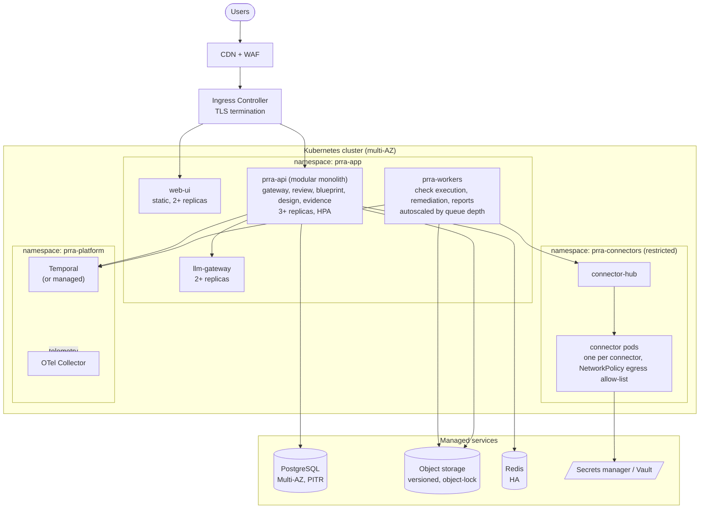
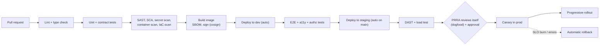

# 03 · Deployment & Operations View

How PRRA is packaged, deployed and operated. PRRA is a **release gate**: it must be reliable, but it is **not in the runtime path of customer traffic**. If PRRA is down, releases fall back to a documented manual process; production keeps running.

---

## 1. Environments

| Environment | Purpose | Data | Connectors |
|---|---|---|---|
| **local** | Developer laptop (`docker compose`) | Seeded sample data | Mock / record-replay only |
| **dev** | Integration; auto-deploy from `main` | Synthetic | Vendor sandboxes / mocks |
| **staging** | Pre-prod rehearsal, DAST, load tests | Anonymised | Sandbox tenants, read-only to real tools where agreed |
| **prod** | Real reviews | Real | Real tools, least-privilege |

## 2. Runtime topology (Kubernetes)

Notes:

- **Stateless pods**, state in managed Postgres/object storage/Redis. Pods are disposable.
- **NetworkPolicies**: `prra-connectors` can reach only the allow-listed external hosts and the hub; nothing in the cluster can reach connector pods except the hub.
- **Pod security**: non-root, read-only filesystem, dropped capabilities, signed images enforced by admission control.
- **Managed Temporal** or self-hosted with its own Postgres; chosen by the platform team ([ADR-0007](../adr/0007-durable-workflow-engine.md)).

## 3. CI/CD for PRRA itself

- **Dogfooding:** every production release of PRRA goes through a PRRA review. It is both a gate and a continuous test.
- **Database migrations** are backward compatible (expand → migrate → contract); never in the same release as dependent code removal.
- **Feature flags** for new connectors and for every remediation type; write capabilities are off by default per environment.

## 4. Data, backup and disaster recovery

| Data | Store | Backup / protection | RPO | RTO |
|---|---|---|---|---|
| Core data (reviews, graphs, results) | PostgreSQL Multi-AZ | PITR + daily snapshots, cross-region copy | ≤ 5 min | ≤ 1 h |
| Evidence and reports | Object storage | Versioning + object lock, cross-region replication | ≈ 0 | ≤ 1 h |
| Workflow state | Temporal DB | Same as Postgres | ≤ 5 min | ≤ 1 h |
| Secrets | Secrets manager | Provider-managed, replicated | n/a | n/a |
| Audit log | Postgres (+ streamed to object lock) | Hash chain, exported daily | ≈ 0 | ≤ 1 h |

PRRA is classified **Tier T1-equivalent for its own review process** (target availability 99.9 %, NFR-04). A **DR drill** (restore into an isolated environment and run a sample review) is performed at least yearly.

## 5. Scaling model

| Dimension | Driver | Lever |
|---|---|---|
| Concurrent runs | Number of reviews running checks | Worker replicas (queue-depth autoscaling) |
| External API limits | ServiceNow / Splunk / Grafana quotas | Per-connector token buckets, caches, run scheduling |
| LLM usage | Design extractions | Gateway cache, budgets, smaller models for extraction |
| UI traffic | Users | Replicas + CDN |
| Data growth | Evidence volume | Lifecycle policies (hot → cold), compression |

Initial sizing target (NFR-03): **500 active reviews, 50 concurrent runs**, comfortably on a small cluster (e.g. 3 nodes).

## 6. Configuration and secrets

- **12-factor** configuration through environment and mounted config; no secrets in images or Git.
- **Org settings** (tiers, severity overrides, approval policy, retention) stored in the database and versioned.
- **Pattern/check packs** pinned by version per environment.

## 7. Operating PRRA itself

PRRA practises what it preaches: it has **SLOs, dashboards, alerts and runbooks** before it goes to production, and passes its own checks.

### SLOs (initial)

| SLI | Objective |
|---|---|
| Review API availability | 99.9 % monthly |
| UI interaction latency (p95) | < 300 ms |
| Check run completion for ~60 checks (p95) | < 3 min |
| Remediation apply success (excluding target-system outages) | ≥ 99 % |
| Connector health (per connector, excluding vendor outages) | ≥ 99 % |

### Key alerts (examples)

| Alert | Why |
|---|---|
| Error-budget burn (fast + slow) on API availability | User pain |
| Workflow backlog age > N min | Runs not progressing |
| Connector `AuthError` / `ContractViolation` spike | Credential expiry or vendor API drift |
| LLM gateway budget > 80 % | Cost control |
| Audit-log hash-chain verification failure | Possible tampering: **page security** |
| Evidence write failures | Cannot guarantee immutability |

### Runbooks (to be written in Phase 0-1)

`api-high-error-rate` · `worker-backlog` · `connector-auth-failure` · `connector-contract-drift` · `database-failover` · `restore-from-backup` · `llm-provider-outage` (falls back to manual manifest mode) · `audit-chain-failure`

### Manual fallback (important)

If PRRA is unavailable, the release process continues with the **manual PRR checklist** (generated from the same check catalog and published as a Markdown/PDF export). A gate must never become a single point of failure for the business.

---

← [Low-Level Design](lld.md) · Back to [docs index](../../README.md#documentation-map)
