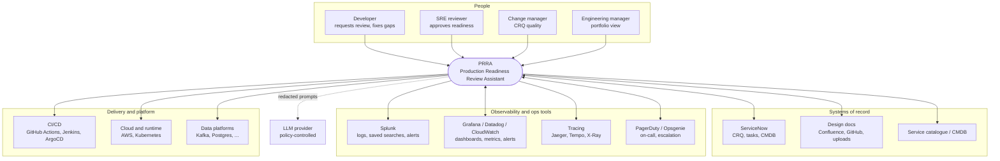
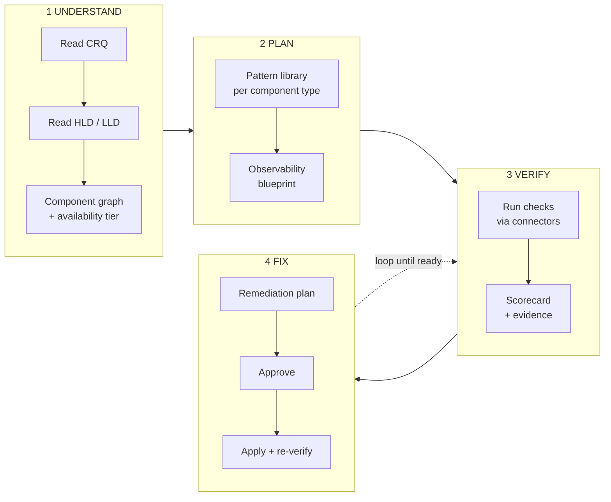
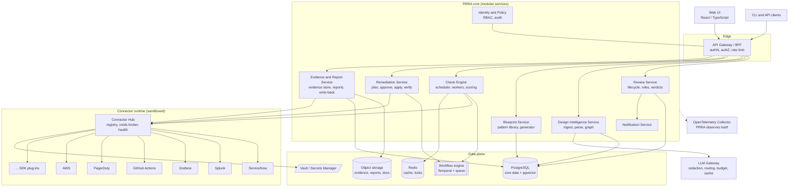
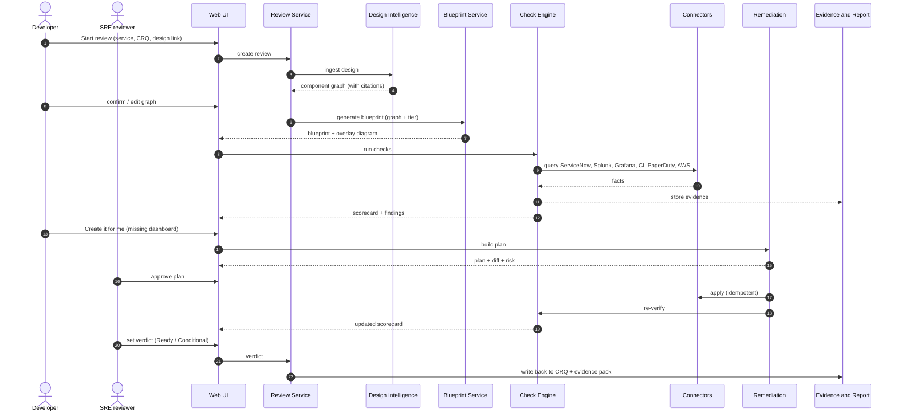
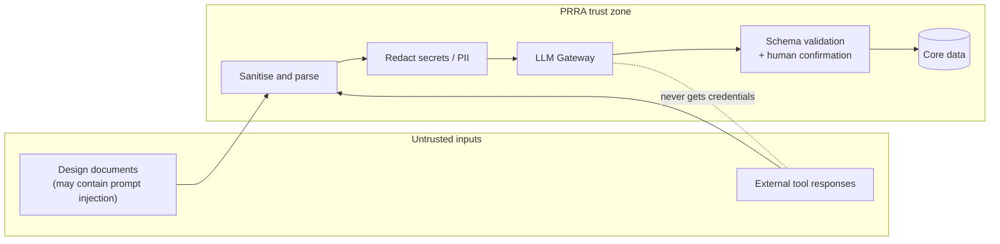

# 03 · High-Level Design (HLD)

> Audience: architects, engineers, SREs, engineering managers.
> Companion: [Low-Level Design](lld.md) · [Observability Blueprint](../04-observability-blueprint.md) · [ADRs](../adr/README.md)

---

## 1. System context (who talks to whom)

PRRA sits **between people and the tools they already use**. It reads from them, scores what it finds, and (when approved) writes back.

**Arrow meaning:** a single arrow is mostly *read*; a double arrow includes *write* (remediation or CRQ write-back), which is always approval-gated.

---

## 2. The big picture in four stages

---

## 3. Container view (deployable pieces)

### Container responsibilities

| Container | Responsibility | State | Scales by |
|---|---|---|---|
| **Web UI** | Review pages, interactive diagrams, approvals | none | CDN / replicas |
| **API Gateway / BFF** | OIDC login, RBAC enforcement, request shaping, rate limiting | none | replicas |
| **Review Service** | Review entity, lifecycle state machine, roles, verdict | Postgres | replicas |
| **Design Intelligence** | Ingest documents, extract component graph with citations, version designs | Postgres, object store, pgvector | workers |
| **Blueprint Service** | Pattern Library; generate requirements per graph + tier; diagram overlay model | Postgres | replicas |
| **Check Engine** | Resolve which checks apply, schedule, execute in parallel, score | workflow state | workers |
| **Remediation Service** | Build plans, enforce approvals, apply idempotent actions, verify, roll back | workflow state | workers |
| **Evidence & Report** | Immutable evidence, report rendering, CRQ write-back | object store + Postgres | workers |
| **Connector Hub + connectors** | Uniform capability API in front of external tools; credential brokering; health | stateless (+ cache) | per connector |
| **LLM Gateway** | Redact, route, budget, cache and log all model calls | Redis, Postgres | replicas |
| **Identity & Policy** | Users, roles, team scoping, audit trail | Postgres | replicas |
| **Notification** | Email / Slack / Teams / webhooks | queue | workers |

> **Start simple:** v1 ships as a **modular monolith** (single deployable with these modules, separate packages) plus separate **connector** and **worker** processes. Boundaries are enforced in code so any module can be split later. See [ADR-0002](../adr/0002-modular-monolith-first.md).

---

## 4. Key flows

### 4.1 End-to-end review (happy path)

### 4.2 Data flow and trust boundaries

Key point: **LLM output is treated as a *suggestion* that must pass schema validation and (for design extraction) human confirmation** before it influences any check. See [Security](../07-security-and-compliance.md).

---

## 5. Architectural characteristics (what we optimise for)

| Characteristic | How the design supports it |
|---|---|
| **Trustworthiness** | Deterministic checks; evidence for every result; AI only assists |
| **Extensibility** | Connector SDK, check DSL, pattern packs, all versioned plug-ins |
| **Safety** | Read-only default; plan → approve → apply; idempotent actions; audit |
| **Explainability** | Findings carry why / how / owner; AI statements cite sources |
| **Operability** | OpenTelemetry everywhere; SLOs for PRRA itself; runbooks |
| **Portability** | Kubernetes + Postgres + S3-compatible storage; no cloud lock-in |
| **Simplicity first** | Modular monolith; boring tech; split only when measured |

## 6. Technology choices (proposed, see ADRs)

| Concern | Choice | Why | Alternatives considered |
|---|---|---|---|
| Backend language | **Python 3.12 + FastAPI** | Best ecosystem for LLM + integrations; fast to build connectors | TypeScript (NestJS), Go, Java |
| Frontend | **React + TypeScript** | Mature; rich diagram libs | Vue, Svelte |
| Diagrams | **Mermaid** (docs + rendering) and **React Flow** (interactive) | Text-diff friendly; GitHub-native | PlantUML, draw.io |
| Primary DB | **PostgreSQL 16 + pgvector** | Relational integrity + embeddings in one store | Separate vector DB |
| Workflow | **Temporal** | Durable long-running remediation / retries / human approval waits | Celery, custom state machine |
| Object store | **S3-compatible** | Evidence, reports | filesystem |
| Cache/locks | **Redis** | Rate-limit, short cache | in-DB |
| Secrets | **Vault / cloud secrets manager** | No secrets in DB | KMS-encrypted columns |
| AuthN | **OIDC/SAML SSO** | Enterprise default | local users (dev only) |
| Telemetry | **OpenTelemetry** → org's backend | Standard | vendor SDKs |
| IaC | **Terraform + Helm** | Common in SRE orgs | Pulumi, CDK |
| LLM | Provider-agnostic gateway; Claude, others configurable | Avoid lock-in; data policy per org | single vendor SDK |

## 7. Cross-cutting concerns (summary)

- **Multi-tenancy:** `org_id` on every row, enforced by row-level security; tenant-scoped connector credentials.
- **Idempotency:** every write carries an idempotency key `(review_id, remediation_item_id, version)`.
- **Rate-limit awareness:** per-connector token buckets; back-off with jitter.
- **Time:** all timestamps UTC; display in user's zone.
- **Config:** 12-factor; feature flags for connectors and remediation types.
- **Failure policy:** *unknown ≠ pass*. Failure to evaluate yields `error`/`skip` and blocks a "Ready" recommendation unless waived.
- **Versioning:** designs, patterns, checks, connectors and reports are all versioned; a review pins the versions it was evaluated with so results are reproducible.

## 8. Risks and mitigations (architecture level)

| Risk | Impact | Mitigation |
|---|---|---|
| LLM mis-reads a design | Wrong blueprint | Human confirmation step; citations; confidence; structured manifest alternative |
| Over-privileged connector credentials | Security incident | Read-only default; scoped tokens; sandbox; audit; short-lived creds where supported |
| Connector API changes / rate limits | Flaky checks | Contract tests with recorded fixtures; back-off; `error` ≠ `fail` |
| Teams game the checks | False confidence | Evidence over attestations; sample deep checks; waiver visibility |
| Tool becomes a bottleneck itself | Slower releases | Manual fallback path; SLO; async design; clear "unknown" handling |
| Pattern library rots | Stale guidance | Ownership, versioning, review cadence, usage analytics |
| Cost of LLM calls | Budget overrun | Gateway budgets, caching, small models for extraction, deterministic fast paths |

Next → [Low-Level Design](lld.md)
