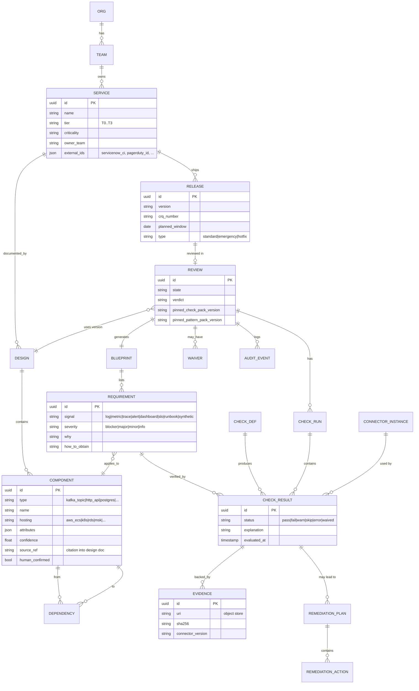
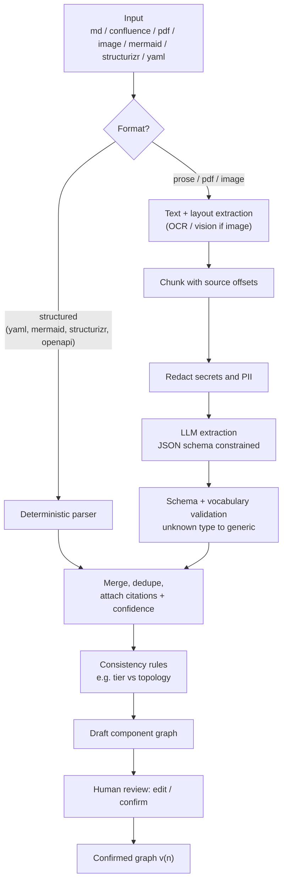
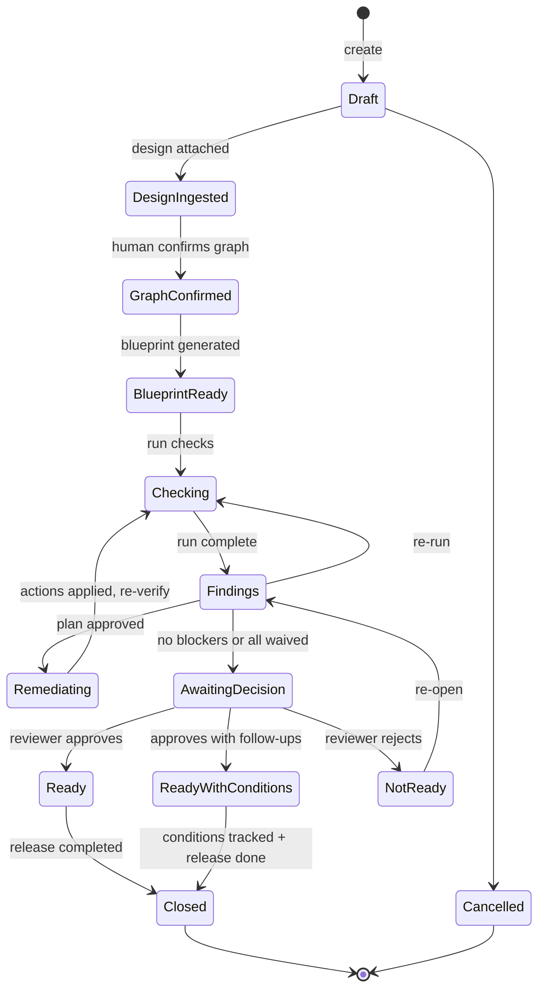
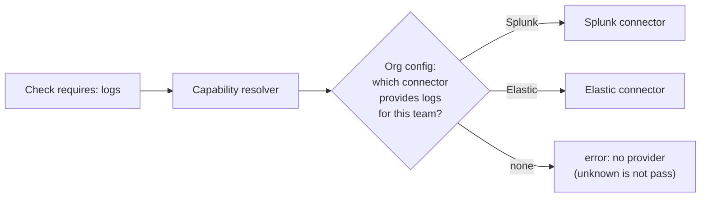
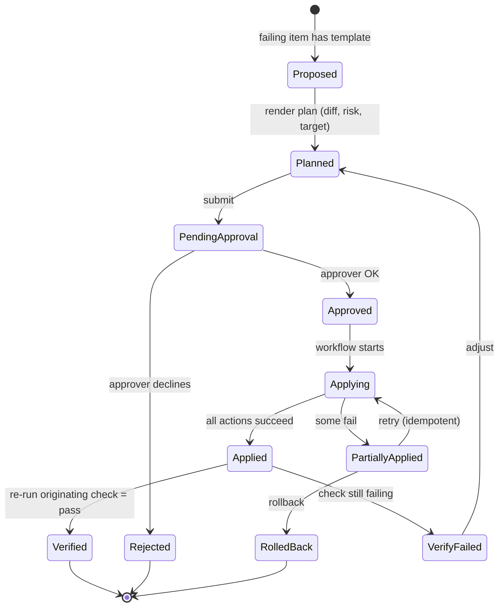

# 03 · Low-Level Design (LLD)

> Companion to the [HLD](hld.md). This is where we get precise: entities, states, interfaces, algorithms.
> All code below is **illustrative contract design**, not an implementation.

---

## 1. Domain model



### Entity notes
- **Component `type`** is a controlled vocabulary (see [Pattern Library](../04-observability-blueprint.md#5-pattern-library)); unknown types map to `generic_service` with a warning.
- **Pinned versions** on `REVIEW` make results reproducible: re-running next year with newer packs does not silently change last year's verdict.
- **Evidence** is write-once; `sha256` makes tampering detectable.

---

## 2. Component graph model (design intelligence output)

```yaml
# Illustrative: a confirmed graph for "orders-api"
service: orders-api
tier: T1
availability:
  slo: { availability: 99.95, latency_p95_ms: 300 }
  rto_minutes: 30
  rpo_minutes: 5
  topology: multi-az            # single-az | multi-az | active-passive | active-active
components:
  - id: api
    type: http_api
    hosting: aws_ecs_fargate
    source_ref: "HLD.md#L42 'Orders API deployed on ECS Fargate behind ALB'"
    confidence: 0.96
  - id: topic-orders
    type: kafka_topic
    hosting: aws_msk
    attributes: { partitions: 12, consumer_groups: [orders-fulfilment] }
  - id: db
    type: postgres
    hosting: aws_rds
    attributes: { multi_az: true, read_replicas: 1 }
edges:
  - { from: api, to: topic-orders, protocol: kafka, mode: async, direction: produce }
  - { from: api, to: db,           protocol: postgres, mode: sync }
```

The `source_ref` + `confidence` fields satisfy **FR-203/NFR-13**: every inferred fact is traceable.

---

## 3. Design-intelligence pipeline (LLD)



**Rules of the road**
1. Structured formats are parsed **without** an LLM (cheaper, deterministic).
2. LLM is used for prose/PDF/image; output must satisfy a JSON schema or it is discarded and retried once.
3. Anything below a confidence threshold (default 0.7) is flagged *"please confirm"*.
4. Only a **human-confirmed graph** can drive the blueprint (setting `human_confirmed = true`).
5. Prompt-injection defence: document text is passed as *data*, never as instructions; tool access is disabled in the extraction call; outputs are schema-only.

---

## 4. Review lifecycle (state machine)



**Guards**
- `GraphConfirmed` requires `human_confirmed` on all components (or explicit "ignore" marks).
- `AwaitingDecision` requires zero open **Blocker** findings, or each has an active, unexpired **Waiver**.
- `Ready` is only reachable by a user with the *Reviewer* role who is **not** the requester (separation of duties).

---

## 5. Check engine

### 5.1 Check definition (declarative DSL)

```yaml
# checks/crq/crq-has-backout-plan.yaml
id: CRQ-004
title: CRQ has a backout plan
category: crq
severity: blocker
applies_to: { release_types: [standard, emergency], tiers: [T0, T1, T2, T3] }
requires: [change_management]            # connector capability
inputs:
  crq: "{{ release.crq_number }}"
evaluate:
  fetch: change_management.get_change(crq)
  rule: |
    change.backout_plan is not empty and length(change.backout_plan) >= 50
pass_message: "Backout plan present ({{ length }} chars)."
fail_message: "The CRQ has no meaningful backout plan."
why_it_matters: "If the release fails, responders need a rehearsed way to return to a known-good state."
fix_hint: "Add rollback steps, owner, and expected duration to the CRQ."
remediation: null                         # humans must write this
evidence: [change.backout_plan, change.updated_at]
```

For complex logic an engineer may write a **Python check** against the same interface (see [Connector & Check SDK](../06-connector-sdk.md)).

### 5.2 Execution pipeline

```mermaid
flowchart LR
    A["Review + pinned packs"] --> B["Select checks<br/>by tier, release type,<br/>components, org overrides"]
    B --> C["Resolve inputs<br/>(CRQ no., service ids)"]
    C --> D["Plan DAG<br/>group by connector, respect rate limits"]
    D --> E["Execute in parallel<br/>timeout / retry / jitter"]
    E --> F["Normalise results<br/>pass / fail / warn / skip / error"]
    F --> G["Store evidence<br/>(hash, immutable)"]
    G --> H["Score + summarise"]
    H --> I["Persist CHECK_RUN"]
```



### 5.3 Status semantics

| Status | Meaning | Blocks "Ready"? |
|---|---|---|
| `pass` | Condition met, evidence stored | no |
| `fail` | Condition not met | **yes** if Blocker/Major (configurable) |
| `warn` | Met partially / advisory | no (shown) |
| `skip` | Not applicable (by tier, type, or component absent) | no |
| `error` | Could not evaluate (connector down, auth, timeout) | **yes** until resolved or waived |
| `waived` | Failed, but approved exception exists and is unexpired | no (shown prominently) |

> **Principle: unknown ≠ pass.** An `error` never turns green by itself.

### 5.4 Scoring

```
category_score = 100 × Σ(weight_i × s_i) / Σ(weight_i)
  s_i: pass=1, warn=0.5, waived=0.5, fail=0, error=0, skip=excluded
  weight: blocker=8, major=4, minor=2, info=1

overall_score = weighted mean of categories (default weights in config)
recommendation:
  any blocker fail/error (unwaived)        → NOT READY
  no blockers but any major fail/error     → READY WITH CONDITIONS
  otherwise                                → READY
```

The **score is a communication aid**; the **recommendation rules** are what gate. Both are shown.

---

## 6. Connector abstraction

```mermaid
classDiagram
    class Connector {
        <<interface>>
        +manifest() Manifest
        +test_connection(ctx) HealthResult
    }
    class ChangeManagement {
        <<capability>>
        +get_change(id) Change
        +list_change_tasks(id) Task[]
        +create_task(id, spec) Task
        +add_work_note(id, text)
        +attach(id, file)
    }
    class Logs {
        <<capability>>
        +search(query, window) LogResult
        +list_saved_searches(scope) SavedSearch[]
        +create_saved_search(spec) SavedSearch
        +create_alert(spec) Alert
    }
    class Metrics {
        <<capability>>
        +query(expr, window) Series
        +list_alert_rules(scope) AlertRule[]
        +create_alert_rule(spec) AlertRule
    }
    class Dashboards {
        <<capability>>
        +find(tags, service) Dashboard[]
        +get(id) Dashboard
        +create(spec) Dashboard
    }
    class Pipeline {
        <<capability>>
        +get_pipeline(repo) Pipeline
        +last_runs(repo, n) Run[]
        +get_gates(repo) Gate[]
    }
    class OnCall {
        <<capability>>
        +get_service(ref) OnCallService
        +get_escalation(id) Policy
        +create_service(spec) OnCallService
    }
    class CloudInventory {
        <<capability>>
        +describe(resource_ref) Resource
        +list_by_tag(tags) Resource[]
    }
    class Catalog {
        <<capability>>
        +get_service(name) CatalogEntry
    }
    class Docs {
        <<capability>>
        +fetch(uri) Document
    }

    Connector <|.. ServiceNowConnector
    Connector <|.. SplunkConnector
    Connector <|.. GrafanaConnector
    Connector <|.. GitHubActionsConnector
    Connector <|.. PagerDutyConnector
    Connector <|.. AwsConnector
    ChangeManagement <|.. ServiceNowConnector
    Logs <|.. SplunkConnector
    Metrics <|.. GrafanaConnector
    Dashboards <|.. GrafanaConnector
    Pipeline <|.. GitHubActionsConnector
    OnCall <|.. PagerDutyConnector
    CloudInventory <|.. AwsConnector
```



**Why capabilities, not vendors?** Checks ask for *"a Logs provider"*, not *"Splunk"*. Swapping Splunk for Elastic means installing a different connector that implements `Logs`; **no check changes**. This is the heart of the extensibility requirement (FR-501).

### 6.1 Capability resolution



---

## 7. Remediation engine



### Remediation template (example)

```yaml
id: REM-GRAF-001
title: Create service overview dashboard
fixes: [OBS-DASH-001]
mode_options: [direct_api, pull_request]      # direct write or raise PR to dashboards repo
inputs: [service, components, datasource_map]
render:
  engine: jsonnet
  template: templates/grafana/service-overview.jsonnet
risk: low
idempotency_key: "{{ review.id }}:{{ service }}:overview:v{{ template.version }}"
rollback: delete_dashboard_by_uid
```

**Safety rails**
- Plans are **rendered and stored before approval**; apply executes *exactly* the approved plan hash.
- Writes target **non-prod first** if configured; production writes need a second approver.
- Every action records *before/after* state to support rollback and audit.
- Remediation is feature-flagged **per connector, per action type**.

---

## 8. Observability overlay model (the "second diagram")

The UI builds the overlay from the blueprint. The data contract:

```json
{
  "review_id": "…",
  "nodes": [
    {
      "component_id": "db",
      "label": "orders-db (Postgres on RDS)",
      "requirements": [
        { "id": "REQ-DB-001", "signal": "metric", "name": "Connections used %", "status": "pass" },
        { "id": "REQ-DB-004", "signal": "alert",  "name": "Replication lag > 30s", "status": "missing",
          "remediation": "REM-AL-012" }
      ],
      "rollup": "partial"
    }
  ],
  "cross_cutting": [
    { "id": "REQ-X-001", "name": "Trace context propagated API → Kafka → consumer", "status": "unknown" }
  ]
}
```

`rollup` ∈ `complete | partial | missing | unknown`, and it drives the chip colour on the diagram. Worked example: [Observability Blueprint §7](../04-observability-blueprint.md#7-worked-example-orders-api).

---

## 9. API surface (REST, v1 – illustrative)

| Method | Path | Purpose |
|---|---|---|
| POST | `/v1/reviews` | Create review (service, release, CRQ) |
| GET | `/v1/reviews/{id}` | Review with summary |
| POST | `/v1/reviews/{id}/designs` | Attach design (url/upload/yaml) |
| GET | `/v1/reviews/{id}/graph` | Draft/confirmed component graph |
| PUT | `/v1/reviews/{id}/graph` | Edit graph |
| POST | `/v1/reviews/{id}/graph:confirm` | Confirm |
| GET | `/v1/reviews/{id}/blueprint` | Requirements + overlay model |
| POST | `/v1/reviews/{id}/runs` | Start check run |
| GET | `/v1/reviews/{id}/runs/{run}` | Results, evidence links |
| POST | `/v1/reviews/{id}/remediations` | Propose plan for finding(s) |
| POST | `/v1/remediations/{id}:approve` | Approve (RBAC + SoD) |
| POST | `/v1/reviews/{id}/waivers` | Request waiver |
| POST | `/v1/reviews/{id}/verdict` | Reviewer decision |
| GET | `/v1/reviews/{id}/report` | Readiness report (html/pdf/md) |
| GET | `/v1/connectors` | List + health |
| POST | `/v1/connectors/{id}:test` | Test connection |
| GET | `/v1/patterns`, `/v1/checks` | Library browse |

Conventions: JSON, `application/problem+json` errors, cursor pagination, `Idempotency-Key` header on POSTs, ETags for optimistic concurrency, webhooks signed with HMAC.

---

## 10. Persistence and consistency

- **Strong consistency** inside a review aggregate (single Postgres transaction).
- **Workflow state** (long-running checks, remediation) lives in Temporal; DB stores the *outcome*.
- **Outbox pattern** for events (verdict changed, finding created) so notifications/webhooks are not lost.
- **Row-level security** by `org_id`; **column-level encryption** for connector config references.
- **Retention**: evidence and audit 13 months default; configurable per org.

## 11. Error handling matrix

| Failure | Behaviour |
|---|---|
| Connector timeout | Retry with jitter ×3 → result `error` (not `fail`) |
| Connector 401/403 | `error` + clear "grant scope X" message, connector marked unhealthy |
| Rate limited (429) | Back-off honoring `Retry-After`; run continues with other checks |
| LLM unavailable | Fall back to deterministic parser / manual graph entry; never block the review |
| Partial remediation | State `PartiallyApplied`; safe retry via idempotency keys; offer rollback |
| Evidence store down | Run fails fast; no result is shown without evidence |
| PRRA down at release time | Documented **manual fallback checklist**; waiver recorded afterwards |

## 12. Observability of PRRA itself

- **Metrics:** runs started/finished, check latency by connector, error rate by connector, LLM tokens/cost, remediation success rate, queue depth.
- **Logs:** structured JSON; `review_id`, `run_id`, `check_id` correlation; secrets scrubbed.
- **Traces:** one trace per run with child spans per check/connector call.
- **SLOs:** run-success ≥ 99 %; p95 run < 3 min; API availability 99.9 %.

Next → [Observability Blueprint](../04-observability-blueprint.md)
