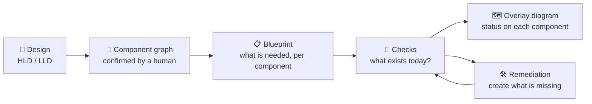
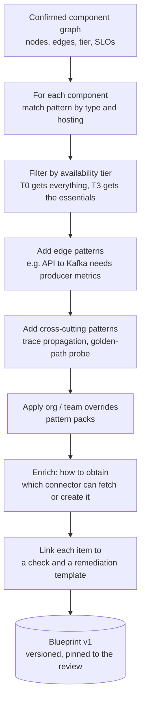
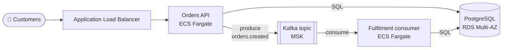
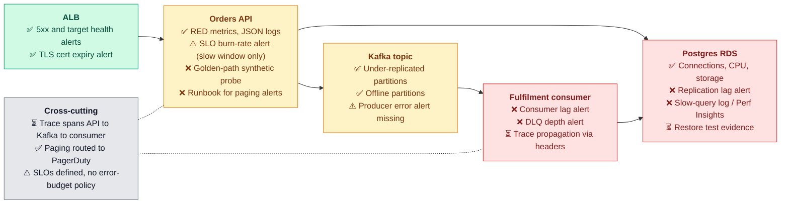
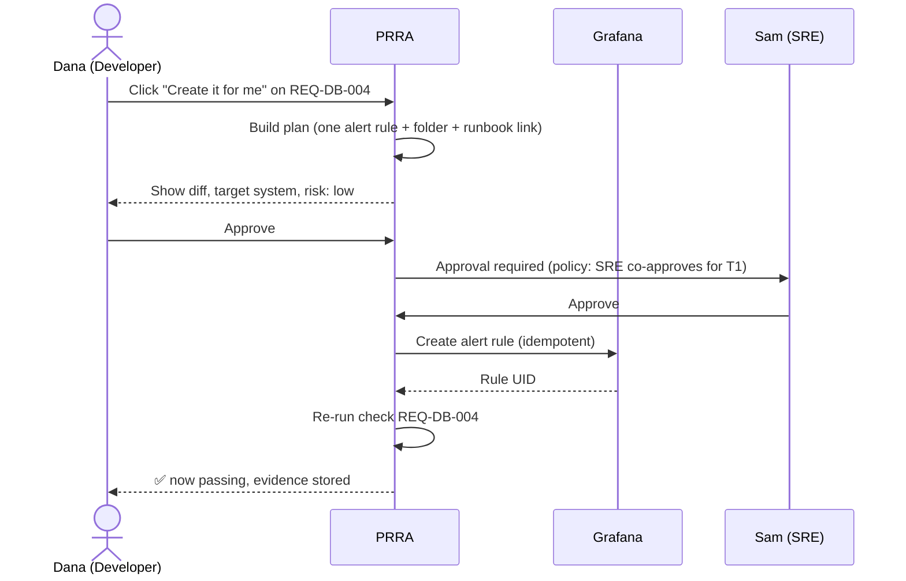
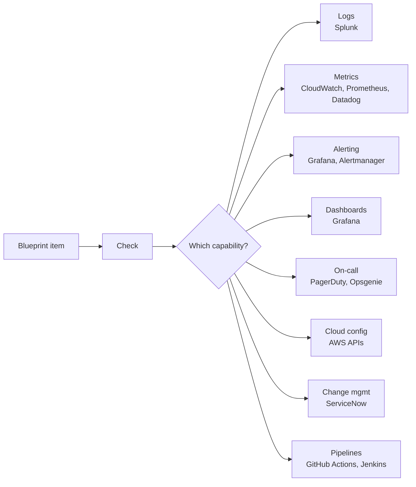

# 04 · Observability Blueprint

> **The idea in one sentence:** give PRRA a design, and it tells you, component by component, exactly which logs, metrics, traces, alerts, dashboards and runbooks you need before going live, how much of that already exists, and how to get the rest.

This is the heart of PRRA and the answer to the original ask: *"when the design comes to me, show another diagram below it: for each component, what observability do we need and how can we get it?"*

---

## 1. Why a blueprint?

Today a senior SRE looks at a design and thinks: *"Kafka, so I need consumer lag. Postgres, so I need replication lag and connection usage. An API behind a load balancer, so error rate and latency SLOs."* That knowledge lives in people's heads.

The blueprint **writes that knowledge down once, as data**, so it is applied the same way to every service, every time, and can be checked automatically.



## 2. How a blueprint is generated



Rules that keep it trustworthy:

- **Deterministic.** The AI helps *read the design* (see [HLD](03-architecture/hld.md)); it does **not** invent requirements. The blueprint comes from the versioned Pattern Library. See [ADR-0004](adr/0004-ai-assists-checks-decide.md).
- **Explainable.** Every item carries a *why* ("without this you cannot see consumers falling behind") and a *how to obtain*.
- **Versioned.** A review pins the pattern versions it used, so results are reproducible.

---

## 3. Availability tiers

The same component needs different observability depending on how critical the service is. A tier is chosen (or derived from SLO/RTO/RPO) when the design is confirmed.

| | **T0** Mission-critical | **T1** Business-critical | **T2** Important | **T3** Standard |
|---|---|---|---|---|
| Availability SLO | 99.99 % | 99.95 % | 99.9 % | 99.5 % |
| Typical RTO / RPO | ≤ 15 min / ≈ 0 | ≤ 30 min / ≤ 5 min | ≤ 4 h / ≤ 1 h | ≤ 24 h / ≤ 24 h |
| Topology expected | Multi-region or active-active | Multi-AZ | Multi-AZ recommended | Single-AZ acceptable |
| On-call | 24×7 page, ack ≤ 5 min | 24×7 page | Business hours page, after-hours ticket | Ticket only |
| Alerting style | Multi-window **SLO burn-rate** + symptom + cause alerts | SLO burn-rate + symptom alerts | Threshold alerts on golden signals | Basic threshold or ticket alerts |
| Synthetic / golden-path probe | ≥ 2 regions, 1 min | 1 region, 1-5 min | optional | none |
| Distributed tracing | Required, ≥ 10 % sampling plus errors always | Required | Recommended | Optional |
| Dashboards | Service + per-component + dependency map | Service + per-component | Service overview | Basic overview |
| Runbooks | Per alert, rehearsed in game day | Per alert | Per service | Short README |
| DR / failover test | Twice a year | Yearly | Documented, not tested | n/a |
| Log retention (hot) | 30 d + 13 m archive | 30 d + 13 m archive | 14 d | 7 d |

> The tier table is **data, not code**: organisations override it in a pattern pack ([§8](#8-pattern-pack-format)).

### Requirement strength

Each blueprint item is marked with the **minimum tier** at which it is required (`T0`..`T3`). For tiers below that it appears as *recommended* (shown, not gating).

---

## 4. The signal taxonomy

PRRA reasons in ten **signal types**. Every blueprint requirement is one of these.

| Signal | Question it answers | Typical sources |
|---|---|---|
| **Logs** | What happened, in detail? | Splunk, CloudWatch Logs, Elastic |
| **Metrics** | How is it behaving over time? | CloudWatch, Prometheus, Datadog |
| **Traces** | Where did this request spend its time? | OpenTelemetry → Tempo / X-Ray / Datadog |
| **Alerts** | Who is told when it breaks? | Grafana alerting, Alertmanager, Splunk alerts |
| **Dashboards** | Can a human see health at a glance? | Grafana, Splunk, Datadog |
| **SLOs** | What does "good enough" mean, and are we burning budget? | Sloth / Grafana SLO / Datadog SLO |
| **Runbooks** | What do I do at 3 a.m. when this alert fires? | Confluence, repo `runbooks/`, wiki |
| **Synthetic checks** | Does the golden path work from outside? | Grafana Synthetic, CloudWatch Synthetics |
| **On-call routing** | Does the alert reach a person who can act? | PagerDuty, Opsgenie |
| **Change markers** | Can we correlate a spike with a deployment? | Annotations from CI/CD |

The **four golden signals** (latency, traffic, errors, saturation) underpin the metrics for every request-serving component. Data stores additionally use **USE** (utilisation, saturation, errors), and consumers use **lag** and **throughput**.

---

## 5. Pattern library

A **pattern** is the observability recipe for one *component type* (optionally specialised by hosting). IDs follow `REQ-<TYPE>-<NNN>`. *Min tier* is the lowest tier at which the item is required.

> Metric names below are **illustrative examples** of the underlying platform's metrics (AWS CloudWatch names for AWS-hosted components). Exact names are resolved by the connector at run time.

### 5.1 HTTP API (e.g. on AWS ECS Fargate behind an ALB)

| ID | Signal | Requirement | Why | How to obtain | Min tier |
|---|---|---|---|---|---|
| REQ-API-001 | Metric | Request rate, error rate (4xx/5xx), latency p50/p95/p99 **per route** | The core golden signals | App instrumentation (OpenTelemetry) or ALB metrics `HTTPCode_Target_5XX_Count`, `TargetResponseTime` | T3 |
| REQ-API-002 | Log | Structured (JSON) request logs with **correlation / trace ID**, status, latency, no PII | Lets you follow one request across systems | App logging config → Splunk / CloudWatch Logs | T3 |
| REQ-API-003 | Metric | Saturation: CPU, memory, running task count vs desired | Shows capacity running out before errors begin | ECS/Container Insights `CpuUtilized`, `RunningTaskCount` | T2 |
| REQ-API-004 | Alert | **SLO burn-rate** alert on availability and latency (fast + slow window) | Pages on user pain, not noise | Grafana / Prometheus rule generated from SLO | T1 |
| REQ-API-005 | Alert | Symptom alert: 5xx ratio above threshold for N minutes | Simple safety net for lower tiers | Grafana alert rule | T2 |
| REQ-API-006 | Metric | Health: unhealthy target count, ALB 5xx (ELB-originated), rejected connections | Detects load balancer-level failure | ALB `UnHealthyHostCount`, `HTTPCode_ELB_5XX_Count` | T2 |
| REQ-API-007 | Trace | Distributed tracing with W3C `traceparent` propagation | End-to-end latency analysis | OpenTelemetry SDK + collector | T1 |
| REQ-API-008 | Metric | Outbound dependency client metrics (timeouts, retries, circuit-breaker state) | Distinguishes "we are slow" from "they are slow" | App instrumentation | T1 |
| REQ-API-009 | Change marker | Deployment annotations on dashboards | Correlate regressions with releases | CI/CD step posts annotation | T2 |
| REQ-API-010 | Synthetic | Golden-path probe (login → place order → read it back) | Detects what internal metrics cannot | Grafana Synthetic / CloudWatch Synthetics | T1 |
| REQ-API-011 | Dashboard | "API health" dashboard: RED + saturation + dependencies | One place to look | Grafana | T3 |
| REQ-API-012 | Runbook | One runbook per paging alert, linked from the alert | Faster, calmer response | Confluence / repo | T1 |

### 5.2 Kafka topic and cluster (e.g. AWS MSK)

| ID | Signal | Requirement | Why | How to obtain | Min tier |
|---|---|---|---|---|---|
| REQ-KFK-001 | Metric + alert | **Under-replicated partitions** > 0 | Data is at risk if another broker fails | MSK `UnderReplicatedPartitions` | T2 |
| REQ-KFK-002 | Metric + alert | **Offline partitions** > 0 | Topic is partly unavailable | MSK `OfflinePartitionsCount` | T1 |
| REQ-KFK-003 | Metric + alert | Broker disk used % (data volume) | Full disk stops the broker | MSK `KafkaDataLogsDiskUsed` | T2 |
| REQ-KFK-004 | Metric | Broker CPU / memory / network | Capacity planning and saturation | MSK CloudWatch metrics | T2 |
| REQ-KFK-005 | Metric | Topic throughput: bytes and messages in/out | Baseline for anomaly detection | MSK topic-level metrics | T3 |
| REQ-KFK-006 | Metric + alert | **Producer** error rate and delivery latency (from the API) | Producers silently dropping messages | Kafka client metrics via OTel/JMX | T1 |
| REQ-KFK-007 | Config check | Retention and replication factor ≥ 3 (T0/T1) with `min.insync.replicas` ≥ 2 | Durability by design | Kafka admin API / IaC | T1 |
| REQ-KFK-008 | Dashboard | "Kafka health" dashboard per cluster and per topic | Single view for brokers and topics | Grafana | T2 |
| REQ-KFK-009 | Runbook | Broker failure, partition reassignment, disk-full | Known, rehearsed responses | Confluence / repo | T1 |

### 5.3 Kafka consumer (service that reads the topic)

| ID | Signal | Requirement | Why | How to obtain | Min tier |
|---|---|---|---|---|---|
| REQ-CON-001 | Metric + alert | **Consumer lag** (offsets) and **time lag** per group/partition | The classic "are we keeping up?" signal | MSK consumer-lag metrics or Burrow / exporter | T2 |
| REQ-CON-002 | Metric | Processing rate, processing time per message | Throughput and slow-consumer detection | App instrumentation | T2 |
| REQ-CON-003 | Metric + alert | Error rate and **dead-letter-queue depth** | Poison messages must be visible | App + DLQ topic metrics | T1 |
| REQ-CON-004 | Metric | Rebalance count and duration | Frequent rebalances = unstable consumers | Kafka client metrics | T2 |
| REQ-CON-005 | Trace | Trace context propagated via message headers | End-to-end trace API → Kafka → consumer | OpenTelemetry Kafka instrumentation | T1 |
| REQ-CON-006 | Design check | Idempotent processing and replay procedure documented | Safe reprocessing after incident | Design doc / runbook | T1 |
| REQ-CON-007 | Dashboard | "Consumer health": lag, rate, errors, DLQ | Single view for the consumer | Grafana | T3 |

### 5.4 PostgreSQL (e.g. AWS RDS)

| ID | Signal | Requirement | Why | How to obtain | Min tier |
|---|---|---|---|---|---|
| REQ-DB-001 | Metric + alert | **Connections used %** of `max_connections` (alert ≥ 80 %) | Exhausted connections cause outages | RDS `DatabaseConnections` vs parameter group | T3 |
| REQ-DB-002 | Metric + alert | CPU utilisation (alert sustained > 80 %) | Saturation | RDS `CPUUtilization` | T3 |
| REQ-DB-003 | Metric + alert | Free storage and **growth forecast** | Full disk = read-only or crash | RDS `FreeStorageSpace` | T2 |
| REQ-DB-004 | Metric + alert | **Replication lag** (alert > 30 s) | Replica reads stale / failover loses data | RDS `ReplicaLag` | T2 |
| REQ-DB-005 | Log | Slow-query log + Performance Insights enabled | Find the query that is hurting | RDS parameter group + PI setting | T2 |
| REQ-DB-006 | Metric + alert | Deadlocks and long-running transactions | Blocking and lock pile-ups | Postgres stats via exporter | T1 |
| REQ-DB-007 | Metric + alert | **Transaction-ID wraparound** headroom | Rare but catastrophic if ignored | RDS `MaximumUsedTransactionIDs` | T1 |
| REQ-DB-008 | Metric | Read/write latency, disk queue depth, freeable memory | Early sign of I/O or memory pressure | RDS CloudWatch metrics | T2 |
| REQ-DB-009 | Evidence | Automated backups on; **restore test** within the last N months | A backup you never restored is a hope | RDS API + test record | T1 |
| REQ-DB-010 | Config check | Multi-AZ enabled (T0/T1), deletion protection, encryption at rest | Matches the availability design | RDS API | T1 |
| REQ-DB-011 | Dashboard | "Database health" dashboard | One place to look | Grafana | T3 |
| REQ-DB-012 | Runbook | Failover, connection storm, disk-full, restore | Rehearsed responses | Confluence / repo | T1 |

### 5.5 Other component types (compact)

| Type | Must-have signals (examples) |
|---|---|
| **Cache (Redis / ElastiCache)** | Hit ratio, evictions, memory %, connected clients, replication lag, latency; alert on evictions and memory ≥ 80 % |
| **Serverless function (Lambda)** | Invocations, errors, throttles, duration p95, iterator age (stream sources), concurrency vs limit, DLQ depth |
| **Batch job / cron** | Last-success timestamp, run duration, failure count, **missed-run alert** ("dead-man's switch") |
| **Object store (S3)** | 4xx/5xx rates, replication status (if replicated), bucket policy / versioning / encryption config checks |
| **Queue (SQS)** | Approximate age of oldest message, queue depth, DLQ depth, receive/delete error rate |
| **External / third-party API** | Outbound success rate and latency (client side), timeout/retry counts, circuit-breaker state, status-page subscription, fallback behaviour documented |
| **Load balancer / CDN** | 5xx at edge, target health, TLS certificate expiry (< 30 d alert), WAF blocked/allowed ratios |

### 5.6 Edge patterns (apply to connections between components)

| Edge | Extra requirement |
|---|---|
| API → Kafka (produce) | Producer metrics + trace header injection (REQ-KFK-006, REQ-CON-005) |
| API → Postgres | Connection-pool metrics (active, idle, wait time) in the API; slow-query correlation by trace ID |
| Service → external API | Timeout and retry budget documented; client-side metrics |
| Any async hop | Lag/age metric on the hop; DLQ with alert |

---

## 6. Cross-cutting requirements

Items that are about the **system**, not one component.

| ID | Requirement | Min tier |
|---|---|---|
| REQ-X-001 | **Trace context propagated** API → Kafka → consumer → database (one trace spans the whole flow) | T1 |
| REQ-X-002 | **Correlation ID** present in every log line and returned to callers | T2 |
| REQ-X-003 | **Dependency map** published (who calls whom, who depends on us) | T2 |
| REQ-X-004 | **Golden-path synthetic check** runs and alerts | T1 |
| REQ-X-005 | **Alert routing**: every paging alert reaches a PagerDuty/Opsgenie service with an escalation policy and at least 2 responders | T1 |
| REQ-X-006 | **SLOs defined** and reviewed (availability + latency) with error-budget policy | T1 |
| REQ-X-007 | **Capacity / load test** evidence for expected peak plus headroom | T1 |
| REQ-X-008 | **Log hygiene**: retention set, PII scrubbed, no secrets in logs | T2 |
| REQ-X-009 | **Ownership** metadata (team, on-call, escalation, Slack channel) in the service catalogue | T3 |

---

## 7. Worked example: orders-api

**The design (from the HLD):** *Orders API* runs on **AWS ECS Fargate** behind an **ALB**. It writes orders to **PostgreSQL on RDS** and publishes `orders.created` events to **Kafka on MSK**. A separate **fulfilment consumer** reads the topic. Tier **T1** (99.95 %, RTO 30 min, RPO 5 min).

### 7.1 Diagram 1: the design (what the developer provides)



### 7.2 Diagram 2: the observability overlay (what PRRA adds)

Each component is annotated with the signals it needs and the **status found by the checks**: ✅ present · ⚠️ partial · ❌ missing · ⏳ not yet checked.



The component colour is the **roll-up**: the worst status among its blocking items (`complete | partial | missing | unknown`, see [LLD §8](03-architecture/lld.md#8-observability-overlay-model-the-second-diagram)).

### 7.3 What the SRE sees when clicking a component (Postgres)

| Requirement | Status | Why it matters | How to get it | Fix |
|---|---|---|---|---|
| REQ-DB-001 Connections used % | ✅ pass | Prevents connection exhaustion | existing alert `orders-db-conn-80` | n/a |
| REQ-DB-004 Replication lag > 30 s | ❌ missing | Replica reads stale; failover can lose data | CloudWatch `ReplicaLag` → Grafana alert | **Create it for me** → `REM-AL-012` |
| REQ-DB-005 Slow-query log + Performance Insights | ❌ missing | Cannot find the slow query during an incident | RDS parameter group + PI setting | Raise PR to team Terraform → `REM-IAC-021` |
| REQ-DB-009 Restore test evidence | ⏳ unknown | Backups only matter if restores work | Upload evidence or link the test ticket | Create ServiceNow task → `REM-TASK-004` |

### 7.4 What "Create it for me" does here



---

## 8. Pattern pack format

Patterns are **YAML packs**, versioned and overridable. Organisations extend rather than fork.

```yaml
# patterns/postgres-rds/REQ-DB-004.yaml
id: REQ-DB-004
component_type: postgres
hosting: [aws_rds, aws_aurora_postgres]
signal: alert
title: Replication lag alert
min_tier: T2
applies_when: "component.attributes.read_replicas > 0"
why: "Stale replicas return old data and a failover could lose recent writes."
how_to_obtain:
  metric: { source: cloudwatch, namespace: AWS/RDS, name: ReplicaLag, dimension: DBInstanceIdentifier }
  alert:  { threshold: "> 30", for: "5m", severity: warning, route: "{{ service.oncall }}" }
verify:
  check: OBS-021            # see 05-checks-catalog.md
remediation:
  template: REM-AL-012      # creates the alert rule in the team's alerting tool
overridable: [threshold, for, severity]
```

Override example for one team:

```yaml
# org-pack/overrides.yaml
extends: core-patterns@1.x
overrides:
  - id: REQ-DB-004
    threshold: "> 10"        # this team is stricter
  - id: REQ-API-010
    min_tier: T2             # require synthetic probes at T2 and above
disabled: [REQ-DB-007]       # Aurora handles this for us
```

---

## 9. Where the data comes from



See the [Connector & Check SDK](06-connector-sdk.md) and the [Checks Catalog](05-checks-catalog.md).

---

← [LLD](03-architecture/lld.md) · Next → [Checks Catalog](05-checks-catalog.md)
