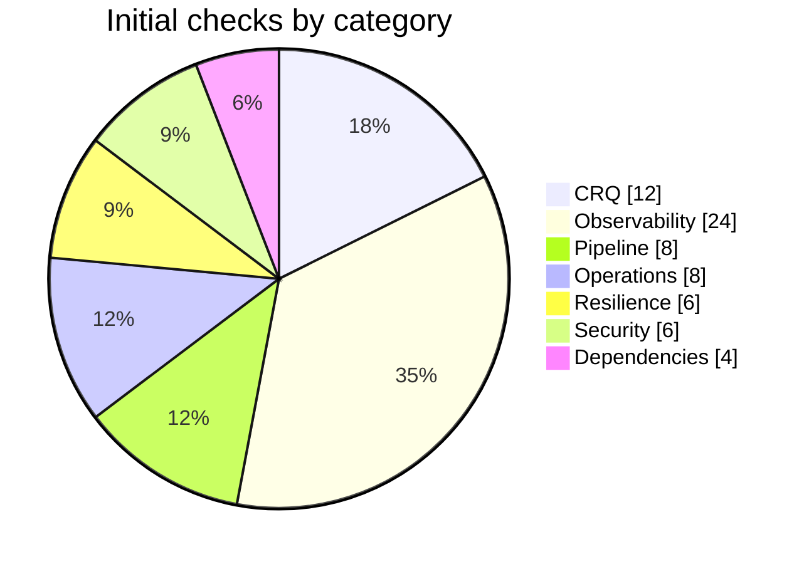

# 05 · Checks Catalog

A **check** is one small, deterministic, evidence-producing question: *"Does the CRQ have a backout plan?"*, *"Is there an alert on consumer lag?"*, *"Did the last pipeline run include a passing security scan?"*

This catalog is the **initial set (68 checks)** that ships with PRRA. It is a starting point: organisations add, tune or disable checks through [pattern and check packs](04-observability-blueprint.md#8-pattern-pack-format). The authoritative definitions live in `checks/` as YAML ([LLD §5.1](03-architecture/lld.md#51-check-definition-declarative-dsl)); this page is the human-readable index.

## How to read the tables

- **Sev**: severity: **B**locker · **M**ajor · m**I**nor · **N**ote (info). Weights and gating rules: [LLD §5.4](03-architecture/lld.md#54-scoring).
- **Tier**: lowest tier at which the check is required (`T0` strictest … `T3` lightest). Below that it is advisory.
- **Needs**: connector capability required ([SDK](06-connector-sdk.md#2-capability-interfaces)). If none is connected the result is `error` (*could not check*), never `pass`.
- **Fix**: remediation template that can create or repair the item ([§9](#9-remediation-templates)), or **manual** if a human must act.

---

## 1. CRQ: is the change request complete? (`CRQ-*`)

Needs: `change_management` (ServiceNow first).

| ID | Check | Sev | Tier | Fix |
|---|---|---|---|---|
| CRQ-001 | CRQ exists, is in an expected state (e.g. *Assess/Authorize*), and matches the service + release | B | T3 | manual |
| CRQ-002 | Short description and description explain **what** changes and **why** (min length, not boilerplate) | M | T3 | manual |
| CRQ-003 | Implementation plan present with ordered steps and owner | B | T3 | manual |
| CRQ-004 | **Backout plan** present and meaningful (≥ 50 chars; steps, owner, duration) | B | T3 | manual |
| CRQ-005 | Test plan and **test evidence** attached (links or attachments) | M | T2 | manual |
| CRQ-006 | Risk and impact assessed; risk level consistent with tier and change type | M | T3 | manual |
| CRQ-007 | Planned start/end inside an approved **change window**; no freeze conflict | B | T2 | manual |
| CRQ-008 | **Change tasks** exist for each required activity (deploy, validate, monitor, rollback) and are assigned | M | T2 | REM-TASK-001 |
| CRQ-009 | Affected **configuration items / service** populated and match the catalogue | M | T2 | manual |
| CRQ-010 | Required **approvals** present (CAB / peer / SRE) or scheduled | B | T2 | manual |
| CRQ-011 | Communication plan (stakeholders, customer notice if user-facing) | m | T1 | REM-TASK-002 |
| CRQ-012 | Post-implementation **monitoring task** with owner and duration (hyper-care) | M | T1 | REM-TASK-003 |

---

## 2. Observability: can we see it? (`OBS-*`)

Needs: `logs`, `metrics`, `alerting`, `dashboards`, `traces`, `oncall`, `cloud`. Items are generated from the blueprint, so the list below is the **core set**; the blueprint adds component-specific ones ([patterns](04-observability-blueprint.md#5-pattern-library)).

### 2.1 Logs

| ID | Check | Sev | Tier | Needs | Fix |
|---|---|---|---|---|---|
| OBS-001 | Application logs for the service are arriving in the log platform (Splunk/CloudWatch) in the last 15 min (non-prod: last 24 h) | B | T3 | logs | manual |
| OBS-002 | Logs are **structured** and contain a correlation / trace ID | M | T2 | logs | manual |
| OBS-003 | Saved searches exist for errors, latency and business-critical events | M | T2 | logs | REM-LOG-001 |
| OBS-004 | Log **retention** meets tier policy | m | T2 | logs / cloud | REM-IAC-010 |
| OBS-005 | No obvious secrets/PII patterns in a sample of recent logs | M | T1 | logs | manual |

### 2.2 Metrics, SLOs and traces

| ID | Check | Sev | Tier | Needs | Fix |
|---|---|---|---|---|---|
| OBS-006 | Golden-signal metrics (rate, errors, duration, saturation) exist for the service | B | T3 | metrics | manual |
| OBS-007 | **SLOs** defined (availability + latency) with targets matching the tier | M | T1 | metrics | REM-SLO-001 |
| OBS-008 | **Error-budget policy** documented and linked | m | T1 | catalog | REM-TASK-005 |
| OBS-009 | Traces are being received; **sampling** matches tier | M | T1 | traces | manual |
| OBS-010 | Trace context propagates across async hops (Kafka headers) | M | T1 | traces | manual |

### 2.3 Dashboards

| ID | Check | Sev | Tier | Needs | Fix |
|---|---|---|---|---|---|
| OBS-011 | A **service overview dashboard** exists and is tagged to the service | B | T2 | dashboards | **REM-DASH-001** |
| OBS-012 | Per-component dashboards exist for each blueprint component | M | T1 | dashboards | REM-DASH-002 |
| OBS-013 | Dashboards show **deployment markers** | m | T2 | dashboards | REM-DASH-003 |
| OBS-014 | Dashboard panels return data (no "No data" on golden signals) | M | T2 | dashboards / metrics | manual |

### 2.4 Alerts and on-call

| ID | Check | Sev | Tier | Needs | Fix |
|---|---|---|---|---|---|
| OBS-015 | At least one **symptom alert** (error rate or latency) exists and is enabled | B | T2 | alerting | **REM-AL-001** |
| OBS-016 | **SLO burn-rate alerts** (fast + slow window) exist | B | T1 | alerting | REM-AL-002 |
| OBS-017 | Every paging alert has a **runbook link** | M | T1 | alerting | REM-DOC-001 |
| OBS-018 | Alerts route to an **on-call service** with an escalation policy | B | T1 | oncall | **REM-OC-001** |
| OBS-019 | On-call schedule has ≥ 2 responders and no gaps in the next 14 days | M | T1 | oncall | manual |
| OBS-020 | A **test page** was delivered successfully within the last 90 days | m | T1 | oncall | REM-OC-002 |
| OBS-021 | Component alerts required by the blueprint exist (e.g. replication lag, consumer lag, DLQ depth) | M | by item | alerting | REM-AL-0xx (e.g. **REM-AL-012**) |
| OBS-022 | **Synthetic / golden-path** probe exists and is green | M | T1 | metrics / synthetics | REM-SYN-001 |
| OBS-023 | Alert noise: no alert fired > N times in 7 days without action (flapping) | N | T2 | alerting | manual |
| OBS-024 | Alerts tested in non-prod (fired at least once on purpose) | m | T1 | alerting | manual |

---

## 3. Pipeline: how does it get to production? (`PIP-*`)

Needs: `cicd`, `source` (GitHub Actions first; Jenkins/ArgoCD next).

| ID | Check | Sev | Tier | Fix |
|---|---|---|---|---|
| PIP-001 | A CI/CD **pipeline** exists for the service and runs on the release commit | B | T3 | REM-IAC-030 (scaffold PR) |
| PIP-002 | Release artifact is **built once and promoted** (same digest in non-prod and prod) | M | T2 | manual |
| PIP-003 | **Automated tests** passed on the release commit (unit + integration) | B | T3 | manual |
| PIP-004 | **Security scans** (SAST, dependency/SCA, container) ran and have no unwaived critical findings | B | T2 | REM-IAC-031 |
| PIP-005 | Deployment uses a **safe strategy** (rolling / blue-green / canary) with automated rollback trigger | M | T1 | manual |
| PIP-006 | **Approval gate** to production exists and matches CRQ approval | M | T2 | manual |
| PIP-007 | Deployment step posts a **change marker** to observability tools | m | T2 | REM-IAC-032 |
| PIP-008 | Infrastructure is defined as code and reviewed (no console-only resources) | M | T1 | manual |

---

## 4. Operations: who runs it? (`OPS-*`)

Needs: `catalog`, `docs`, `oncall`.

| ID | Check | Sev | Tier | Fix |
|---|---|---|---|---|
| OPS-001 | **Service ownership** in catalogue (team, escalation, Slack/Teams channel) | B | T3 | REM-CAT-001 |
| OPS-002 | **Runbook** exists for each blueprint alert and for deploy / rollback | M | T1 | REM-DOC-001 |
| OPS-003 | **Rollback procedure** tested in non-prod within the last 6 months | M | T1 | manual |
| OPS-004 | **Capacity / load test** evidence for peak + headroom (≥ 30 % by default) | M | T1 | manual |
| OPS-005 | **Support handover**: SRE/on-call team has reviewed and accepted (sign-off) | B | T1 | manual |
| OPS-006 | Dependencies and **downstream impact** documented; dependent teams informed | m | T2 | manual |
| OPS-007 | **Feature flags / kill switch** for risky new behaviour | m | T1 | manual |
| OPS-008 | Customer-facing **status communication** plan (if user-facing) | m | T1 | manual |

---

## 5. Resilience: what happens when things break? (`RES-*`)

Needs: `cloud`, `docs`.

| ID | Check | Sev | Tier | Fix |
|---|---|---|---|---|
| RES-001 | **Topology matches tier** (multi-AZ for T0-T2 data stores and compute; multi-region for T0) | B | T1 | manual |
| RES-002 | **Backups** enabled and a **restore test** completed within policy | B | T1 | REM-TASK-004 |
| RES-003 | **RTO/RPO** documented and consistent with the design | M | T1 | manual |
| RES-004 | **DR / failover test** completed within tier policy | M | T0 | manual |
| RES-005 | **Timeouts, retries with back-off and circuit breakers** documented for outbound calls | M | T1 | manual |
| RES-006 | **Autoscaling** or capacity limits configured and alarmed | m | T2 | REM-IAC-040 |

---

## 6. Security: the basics, verified (`SEC-*`)

PRRA does not scan; it verifies that required security steps happened and passed.

| ID | Check | Sev | Tier | Needs | Fix |
|---|---|---|---|---|---|
| SEC-001 | Threat model / security review **sign-off** recorded | M | T1 | docs / catalog | manual |
| SEC-002 | **Secrets** come from a secrets manager (no plaintext in repo / task definition) | B | T2 | cloud / source | manual |
| SEC-003 | **TLS** everywhere; certificate valid > 30 days | M | T2 | cloud | REM-IAC-050 |
| SEC-004 | Data stores **encrypted at rest**; public access blocked | B | T2 | cloud | REM-IAC-051 |
| SEC-005 | **IAM least privilege** review done (no wildcard admin for the service role) | M | T1 | cloud | manual |
| SEC-006 | Audit logging enabled for the service's critical actions | m | T1 | cloud / logs | manual |

---

## 7. Dependencies: what do we rely on? (`DEP-*`)

Needs: `catalog`, `metrics`.

| ID | Check | Sev | Tier | Fix |
|---|---|---|---|---|
| DEP-001 | All upstream/downstream dependencies **declared** in the catalogue and match the design graph | M | T2 | REM-CAT-002 |
| DEP-002 | Each dependency has an **SLO/SLA** known and compatible with ours (a 99.95 % service cannot rely on a 99 % one without a fallback) | M | T1 | manual |
| DEP-003 | Dependency owners **notified** of expected load change | m | T2 | REM-TASK-006 |
| DEP-004 | **Fallback / degradation** behaviour defined for each hard dependency | M | T1 | manual |

---

## 8. Result semantics (recap)

`pass` · `fail` · `warn` · `skip` (not applicable) · `error` (could not check) · `waived`. **Unknown is not pass:** if a connector is down or lacks permission, the result is `error` and it still blocks a *Ready* recommendation until resolved or waived. See [LLD §5.3](03-architecture/lld.md#53-status-semantics).

## 9. Remediation templates

| Prefix | Creates / changes | Default delivery |
|---|---|---|
| `REM-DASH-*` | Grafana dashboards (overview, per component, deployment markers) | Direct API **or** PR with Jsonnet/JSON |
| `REM-AL-*` | Alert rules (symptom, burn-rate, component alerts like `REM-AL-012` replication lag) | Direct API **or** PR (Terraform / Grafana provisioning) |
| `REM-LOG-*` | Splunk saved searches and alerts | Direct API |
| `REM-OC-*` | PagerDuty service, escalation policy, routing, test page | Direct API |
| `REM-TASK-*` | ServiceNow change tasks, follow-up tasks | Direct API |
| `REM-SLO-*` | SLO definitions + generated burn-rate rules | PR |
| `REM-SYN-*` | Synthetic checks | Direct API **or** PR |
| `REM-DOC-*` | Runbook skeletons in Confluence / repo | PR |
| `REM-CAT-*` | Service catalogue entries | Direct API |
| `REM-IAC-*` | Terraform/Helm changes (parameter groups, retention, pipeline scaffolds, encryption) | **Always a PR** |

Every remediation follows **plan → approve → apply → verify** ([LLD §7](03-architecture/lld.md#7-remediation-engine)).

## 10. Adding your own check

1. Copy a similar YAML from `checks/` and set a new ID in your organisation prefix (e.g. `ACME-OBS-001`).
2. Declare `requires:` (capability), `applies_to:`, `evaluate:`, messages, `why_it_matters`, `fix_hint`.
3. Add a **record/replay fixture** so the check is testable without live systems ([SDK §6](06-connector-sdk.md#6-testing-connectors-and-checks)).
4. Add to your pack, bump the pack version. Reviews that pinned the old version are unaffected.

---

← [Observability Blueprint](04-observability-blueprint.md) · Next → [Connector & Check SDK](06-connector-sdk.md)
