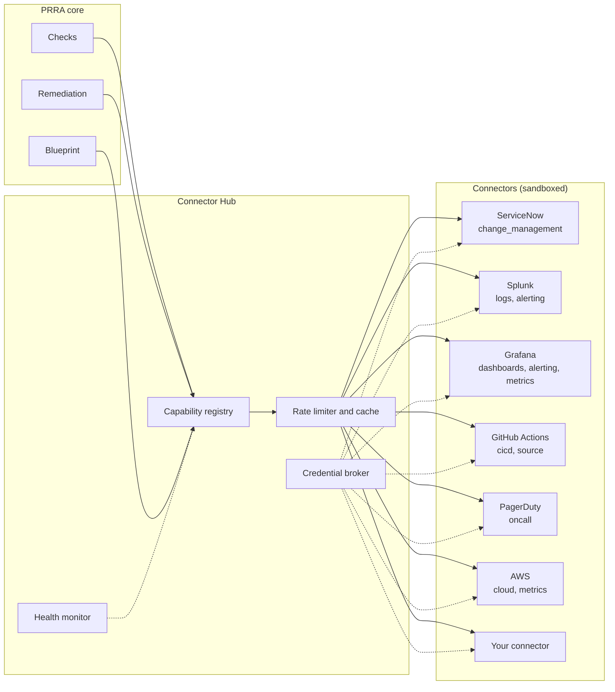
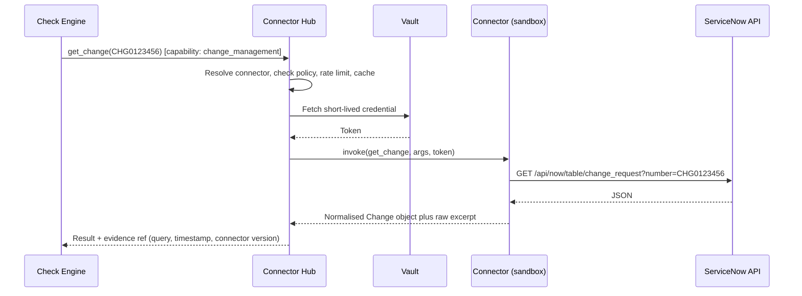
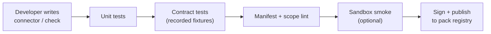

# 06 · Connector & Check SDK

PRRA must work with **whatever tools an organisation already uses**: ServiceNow today, Jira tomorrow; Splunk here, Datadog there. This document describes how that extensibility works.

> **Design principle:** the core talks to **capabilities** ("get a change request", "search logs", "create an alert"), never to a specific product. A *connector* is a plug-in that implements one or more capabilities for one product.

---

## 1. The mental model



Checks say *"I need `change_management`"*. The hub finds the configured connector that provides it. Swapping ServiceNow for Jira changes **configuration, not checks**.

---

## 2. Capability interfaces

| Capability | Typical operations (read ▸ write) | First-party connectors |
|---|---|---|
| `change_management` | `get_change`, `list_change_tasks`, `get_approvals` ▸ `create_task`, `add_work_note`, `attach` | **ServiceNow**; next: Jira, BMC Remedy |
| `logs` | `search`, `list_saved_searches`, `get_retention` ▸ `create_saved_search`, `create_alert` | **Splunk**; next: Elastic, CloudWatch Logs |
| `metrics` | `query`, `list_metrics`, `list_slos` ▸ `create_slo` | **Grafana** (Prometheus/Mimir), **AWS CloudWatch**; next: Datadog |
| `dashboards` | `find`, `get` ▸ `create`, `update` | **Grafana**; next: Datadog, Splunk dashboards |
| `alerting` | `list_alert_rules`, `get_routing` ▸ `create_alert_rule`, `update_alert_rule` | **Grafana**, **Splunk**; next: Alertmanager |
| `oncall` | `get_service`, `get_escalation_policy`, `get_schedule` ▸ `create_service`, `create_policy`, `send_test_page` | **PagerDuty**; next: Opsgenie |
| `cicd` | `get_pipeline`, `get_runs`, `get_run_artifacts`, `get_scan_results` ▸ `open_pr` | **GitHub Actions**; next: Jenkins, ArgoCD, GitLab CI |
| `source` | `get_file`, `search_code`, `list_prs` ▸ `open_pr` | **GitHub**; next: GitLab, Bitbucket |
| `cloud` | `describe_resource`, `list_resources`, `get_config`, `get_tags` | **AWS** (read-only); next: Azure, GCP, Kubernetes |
| `catalog` | `get_service`, `get_dependencies` ▸ `upsert_service` | Backstage / custom; ServiceNow CMDB |
| `docs` | `get_page`, `search` ▸ `create_page` | **Confluence**; next: Notion, GitHub Markdown |
| `traces` | `query_traces`, `get_sampling` | Tempo, X-Ray; next: Datadog APM |

Each capability is a typed interface with a JSON schema. Read operations are **always safe by default**; write operations are separate methods guarded by policy and approvals.

```python
# Illustrative SDK shape (Python)
from prra_sdk import Connector, capability, Manifest, Change, Task

class ServiceNowConnector(Connector):
    manifest = Manifest.from_file("manifest.yaml")

    @capability("change_management")
    async def get_change(self, ctx, number: str) -> Change:
        rec = await ctx.http.get(f"/api/now/table/change_request",
                                 params={"sysparm_query": f"number={number}",
                                         "sysparm_display_value": "all"})
        return Change.from_servicenow(rec["result"][0])

    @capability("change_management", write=True)
    async def create_task(self, ctx, number: str, spec: dict) -> Task:
        ...
```

---

## 3. The connector manifest

Every connector ships a manifest. The hub uses it for discovery, validation, least-privilege prompts and rate limiting.

```yaml
# manifest.yaml
name: servicenow
version: 1.2.0
display_name: ServiceNow
sdk_version: ">=1.0,<2.0"
capabilities:
  change_management:
    read:  [get_change, list_change_tasks, get_approvals]
    write: [create_task, add_work_note, attach]
auth:
  methods: [oauth2_client_credentials, basic]   # basic only for dev
  scopes_required:
    read:  ["table:change_request:read", "table:change_task:read", "table:sysapproval_approver:read"]
    write: ["table:change_task:write", "table:sys_journal_field:write", "attachment:write"]
config_schema:
  instance_url: { type: string, format: uri, required: true }
  table_overrides: { type: object }       # custom fields mapping
rate_limit: { requests_per_minute: 120, burst: 20 }
egress_allow: ["*.service-now.com"]
test_connection: { operation: get_change, args: { number: "CHG0000001" }, expect: "found_or_not_found" }
```

Why this matters:

- **Least privilege:** read scopes are requested first; write scopes only when remediation is enabled for that connector.
- **Sandbox:** egress is limited to `egress_allow`.
- **Self-service admin UX:** the config schema renders the setup form automatically.

---

## 4. How a connector runs



- **Credentials never touch the core or the LLM.** The broker injects them for a single call.
- **Evidence** (the raw excerpt, query, timestamp, connector version) is captured on every call, which is what makes every result auditable.
- **Failure is explicit.** A timeout, `401`, `403`, `429` or schema mismatch becomes a structured `ConnectorError` that the check engine turns into status `error` (*could not check*), never `pass`.

### Connector error taxonomy

| Error | Meaning | Engine behaviour |
|---|---|---|
| `AuthError` | Credential invalid/expired | `error`; raise connector-health alert |
| `PermissionError` | Credential lacks scope | `error`; tell admin which scope |
| `NotFound` | Object absent | Often a legitimate `fail` (e.g. no dashboard); the check decides |
| `RateLimited` | 429 | Back off with jitter, retry within budget |
| `Unavailable` | 5xx / timeout | Retry; then `error` |
| `ContractViolation` | Response did not match schema | `error`; alert maintainers (API drift) |

---

## 5. Connector sketches (first-party)

| Connector | Main APIs used | Notes |
|---|---|---|
| **ServiceNow** | Table API: `change_request`, `change_task`, `sysapproval_approver`, `sys_attachment`; journal fields for work notes | Field mapping is configurable (custom fields are common) |
| **Splunk** | REST: `/services/search/jobs` (search), `/services/saved/searches` (saved searches/alerts), index and retention endpoints | Searches are bounded by time and `max_count` |
| **Grafana** | `/api/search` (dashboards), `/api/dashboards/db` (create), provisioning API for alert rules, data-source proxy for metric queries | Prefers **dashboards-as-code PR** when configured |
| **GitHub Actions** | `/repos/{o}/{r}/actions/workflows`, `/runs`, `/artifacts`, code scanning alerts API, Pull Requests API | Used for PIP checks and for opening remediation PRs |
| **PagerDuty** | REST v2: `/services`, `/escalation_policies`, `/schedules`, `/oncalls`; Events API for test page | Test pages are rate-limited and flagged in audit |
| **AWS** | Read-only via a cross-account role: RDS, MSK, ECS, ELB/ALB, CloudWatch, Resource Groups Tagging | `ViewOnlyAccess`-style scoped role; no write by default |

> These are design sketches. Exact endpoints and scopes are finalised when each connector is built, against the vendor's current API documentation.

---

## 6. Testing connectors and checks

| Layer | How | Why |
|---|---|---|
| **Unit** | Pure functions (mapping, rule evaluation) | Fast feedback |
| **Contract** | Record real (sanitised) vendor responses → replay as fixtures; schema validation | Detect API drift without live calls |
| **Record/replay** | `prra-sdk record` captures calls; `replay` serves them in CI | Deterministic CI |
| **Mock connector** | A built-in in-memory fake for every capability | Demos, local dev, onboarding (FR-507) |
| **Live smoke (opt-in)** | Nightly against sandbox tenants | Catches real-world breaks |

A new check or connector is **mergeable only with fixtures** (a happy-path and at least one failure case per check).



---

## 7. Check SDK: two ways to write a check

| | **Declarative (YAML)** | **Code (Python)** |
|---|---|---|
| For | 90 % of checks | Complex logic, multi-call correlation |
| Example | [`CRQ-004`](03-architecture/lld.md#51-check-definition-declarative-dsl) | Cross-checking cloud config against the design graph |
| Who | SREs, anyone | Engineers |
| Testing | Fixtures | Fixtures + unit tests |

```python
from prra_sdk import check, Result

@check(id="OBS-018", category="observability", severity="blocker",
       requires=["alerting", "oncall"], tiers=["T0", "T1"])
async def alerts_route_to_oncall(ctx):
    rules = await ctx.alerting.list_alert_rules(scope=ctx.service)
    paging = [r for r in rules if r.severity in ("critical", "page")]
    if not paging:
        return Result.fail("No paging alerts found.", evidence=rules.excerpt())
    svc = await ctx.oncall.get_service(ctx.service.oncall_ref)
    if not svc or not svc.escalation_policy:
        return Result.fail("Paging alerts exist but no on-call escalation policy.",
                           evidence=[rules.excerpt(), svc])
    return Result.passed(f"{len(paging)} paging alerts routed to {svc.name}.",
                         evidence=[rules.excerpt(), svc])
```

---

## 8. Packs: distributing extensions

A **pack** bundles any mix of *connectors*, *checks*, *patterns*, *remediation templates*.

```
acme-pack/
  pack.yaml                # name, version, dependencies, signatures
  connectors/…
  checks/…
  patterns/…
  remediations/…
  fixtures/…
```

- **Versioned** and **pinned** per review.
- **Signed**; the registry verifies signatures (supply-chain protection, see [Security](07-security-and-compliance.md#7-supply-chain)).
- **Scoped**: install per organisation or per team.

---

← [Checks Catalog](05-checks-catalog.md) · Next → [Security & Compliance](07-security-and-compliance.md)
