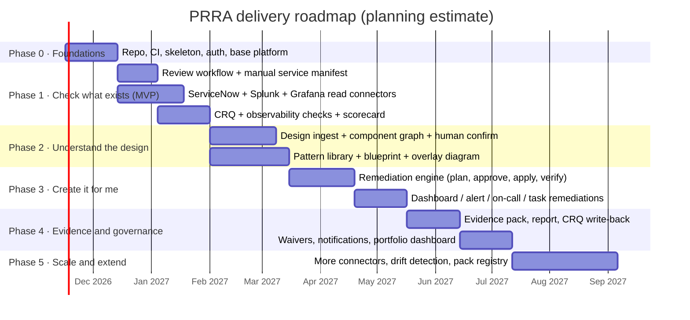
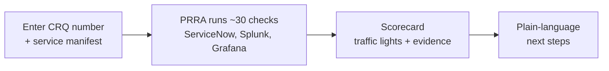

# 08 · Roadmap, Team and Delivery Plan

How we get from this design to a working product, in small, valuable slices. **Each phase ends with something a real SRE can use.**

> Dates are **planning estimates** for a team of the size in [§3](#3-the-team). They are meant to be re-planned at every phase boundary.

---

## 1. Phases at a glance

## 2. Phase details

| Phase | Goal | Delivers | Exit criteria ("done when…") | Primary epics |
|---|---|---|---|---|
| **0 · Foundations** | A runnable, deployable skeleton with good engineering hygiene | Repo structure, CI/CD, IaC for a dev environment, SSO, audit log skeleton, OTel from day one, first ADRs implemented | `main` deploys automatically to dev; every PR runs lint, tests, scans; PRRA emits its own telemetry | E8, E10 |
| **1 · Check what exists (MVP)** | Replace the "open six tabs" ritual | Create a review from a CRQ; **manual service manifest**; ServiceNow, Splunk, Grafana (read-only) connectors; ~30 core checks; scorecard with evidence and plain-language explanations | A pilot SRE can complete a real review for one service faster than by hand, with evidence | E1, E4, E5, E9 |
| **2 · Understand the design** | The "second diagram" | HLD/LLD ingestion (Markdown, Mermaid, Confluence first), component graph with citations and human confirmation, **pattern library v1** (API, Kafka, consumer, Postgres), blueprint + **overlay diagram** | For the orders-api example, the overlay matches an SRE's own list ≥ 90 %; extraction corrections feed back into tests | E2, E3, E9 |
| **3 · Create it for me** | Close gaps without ticket ping-pong | Remediation plans with diff and approval; Grafana dashboards/alerts, Splunk searches, PagerDuty service, ServiceNow tasks; PR-based (as-code) delivery; verify-after-apply | A developer fixes a missing dashboard and alert in minutes, with SRE approval, and the check turns green | E6 |
| **4 · Evidence & governance** | Make it auditable and organisation-wide | Evidence packs, readiness report (HTML/PDF), **CRQ write-back**, waivers with expiry, notifications, portfolio dashboard | An auditor can reproduce a past verdict from stored evidence; leaders see readiness trends | E7, E9 |
| **5 · Scale & extend** | Make it a platform | Connectors (Datadog, Prometheus, Jenkins, ArgoCD, Opsgenie, Jira, Kubernetes), drift detection (FR-410), signed pack registry, multi-tenant hardening | A second team writes a connector in ≤ 2 days (NFR-11) | E5, E8 |

### MVP slice (what we would show to a first stakeholder)

Small on purpose: it proves the **hard integration and trust questions** (connectors, evidence, "unknown ≠ pass") before the AI and remediation layers are added.

---

## 3. The team

A real project needs every viewpoint. This is the working agreement for how roles contribute.

| Role | Responsibility on PRRA |
|---|---|
| **Product Owner** | Owns the backlog and priorities; defines what "ready" means for stakeholders; runs pilot with SRE teams |
| **Architect (tech lead)** | Owns this design set, ADRs, quality attributes; guards the boundaries |
| **Backend engineers (2-3)** | Core services, check engine, connector hub, remediation |
| **Integration engineers (1-2)** | Connectors, SDK, record/replay fixtures |
| **Frontend engineer (1-2)** | Review UI, interactive diagrams, accessibility |
| **ML / applied-AI engineer (1)** | Design extraction, prompts, eval harness, LLM gateway |
| **SRE / domain expert (1, embedded)** | Pattern library content, check semantics, pilot feedback |
| **Platform / DevOps (1)** | Kubernetes, IaC, CI/CD, secrets, observability of PRRA |
| **QA / test engineer (1)** | Test strategy, fixtures, end-to-end, accessibility and security tests |
| **Security champion (part-time)** | Threat model reviews, pen test coordination |
| **Technical writer / designer (part-time)** | Docs, diagrams, UX |

## 4. Ways of working

- **Two-week sprints**, sprint review with an SRE in the room, retro.
- **Trunk-based** development with short-lived branches; PRs need one approval; docs and ADRs are reviewed like code.
- **Definition of Ready** for a story: linked requirement (FR/NFR), acceptance criteria (Given/When/Then), design notes, test approach.
- **Definition of Done**: code + tests + docs updated; telemetry added; security checks green; feature flag documented; demo-able.
- **ADRs** for any decision that is hard to reverse ([ADR index](adr/README.md)).
- **Dogfooding:** PRRA is itself reviewed with PRRA before each production release.

## 5. Success measures

| Measure | Baseline (today, to be measured in the pilot) | Target |
|---|---|---|
| Median time to complete a readiness review | Days | < 4 working hours |
| % of reviews with gaps found **before** the release week | Unknown | ≥ 80 % |
| Production incidents caused by missing observability | Tracked per quarter | −50 % in 12 months |
| Reviewer consistency (two SREs, same service, same verdict) | Subjective | ≥ 90 % agreement |
| Developer satisfaction ("I knew exactly what was needed") | n/a | ≥ 4 / 5 |
| Gaps fixed through "Create it for me" | 0 | ≥ 40 % of fixable gaps |
| False-ready rate (service rated Ready, then incident due to a check gap) | Unknown | < 2 % |

## 6. Top delivery risks

| Risk | Likelihood | Impact | Response |
|---|---|---|---|
| Connector access is slow to obtain (security approvals, sandboxes) | High | High | Start access requests in Phase 0; mock connectors keep the team moving |
| Design documents vary wildly in quality | High | Medium | Structured **manifest** path (FR-207) from day one; human confirmation; extraction evals on real samples |
| Check semantics disputed between SRE teams | Medium | High | Packs and overrides; start with a narrow, agreed core; product owner arbitrates |
| Scope creep into "a monitoring platform" | Medium | Medium | Non-goals NG1-NG5 in the [vision](01-vision-and-product-brief.md) |
| Teams game the checks | Medium | Medium | Evidence over attestation; sampled deep checks; visible waivers |

---

← [Security & Compliance](07-security-and-compliance.md) · Next → [UX & Journeys](09-ux-and-journeys.md)
