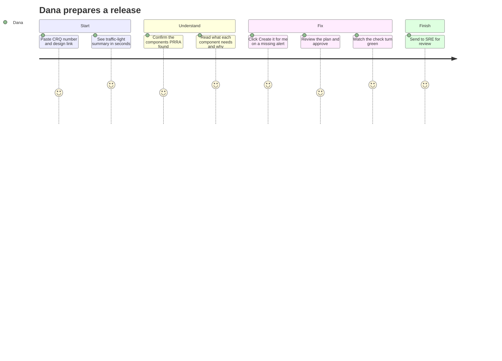
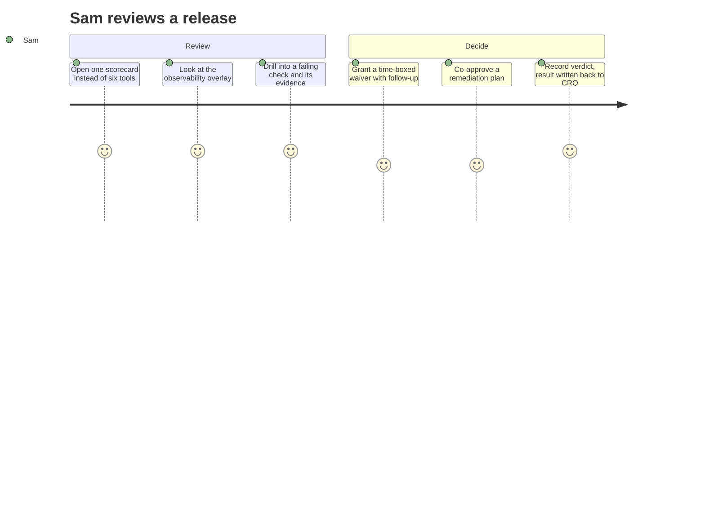
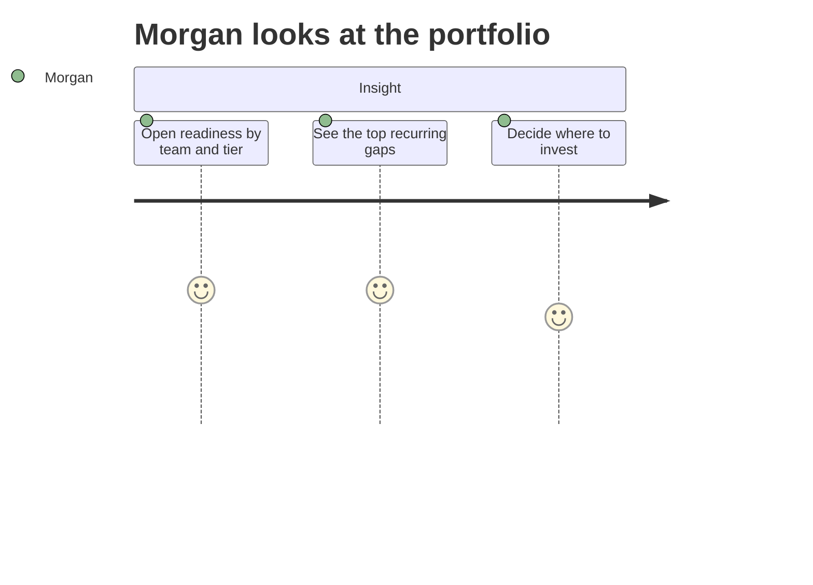
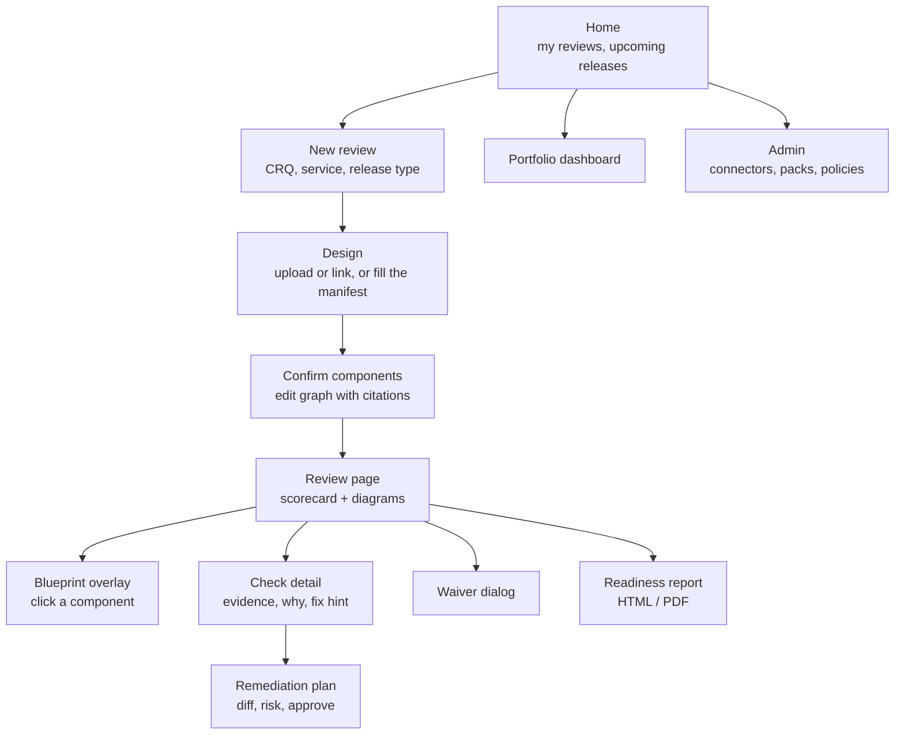

# 09 · Experience: Journeys and Screens

PRRA has to make sense to a developer, an SRE, a change manager and a director. This page shows **who does what** and **what they see**.

---

## 1. User journeys

### Dana (Developer), "What do I still need to do?"



### Sam (SRE Reviewer), "Can I trust this release?"



### Morgan (Engineering manager), "Where are we weak?"



---

## 2. Screen map



## 3. The review page (wireframe)

```text
┌───────────────────────────────────────────────────────────────────────────────┐
│ orders-api · Release 2026.11.2 · CRQ CHG0123456 · Tier T1        [Re-run checks]│
├───────────────────────────────────────────────────────────────────────────────┤
│  RECOMMENDATION:  🟠 READY WITH CONDITIONS        Score 82 / 100                │
│  "2 major gaps to fix before go-live. No blockers."   (Decision by: Sam, SRE)  │
│                                                                               │
│  CRQ 🟢 11/12     Observability 🟠 19/24     Pipeline 🟢 8/8     Ops 🟠 6/8     │
│  Resilience 🟢 6/6      Security 🟢 6/6      Dependencies 🟠 3/4               │
├───────────────────────────────────────────────────────────────────────────────┤
│  DESIGN                                                                        │
│  [Customers]──▶[ALB]──▶[Orders API]──▶[Postgres]                               │
│                              └──▶[Kafka topic]──▶[Fulfilment consumer]         │
│                                                                               │
│  OBSERVABILITY OVERLAY (click a component)                                     │
│  [ALB ✅]──▶[Orders API ⚠️]──▶[Postgres ❌]                                     │
│                   └──▶[Kafka ⚠️]──▶[Consumer ❌]      Cross-cutting ⏳           │
├───────────────────────────────────────────────────────────────────────────────┤
│  NEXT ACTIONS                                                                  │
│  ❌ Replication lag alert missing (Postgres)        [Create it for me] [Explain]│
│  ❌ Consumer lag alert missing (Consumer)           [Create it for me] [Explain]│
│  ⚠️ Golden-path probe missing (API)                 [Create it for me] [Explain]│
│  ⚠️ CRQ lacks post-implementation monitoring task   [Create task]      [Explain]│
└───────────────────────────────────────────────────────────────────────────────┘
```

## 4. Design principles for the UI

| Principle | In practice |
|---|---|
| **Answer first** | Recommendation and next actions above the fold; detail on demand |
| **Never just a colour** | Icons + text for status (accessibility, WCAG 2.1 AA) |
| **Explain, don't scold** | Every finding: what, why it matters, how to fix, who can |
| **Evidence one click away** | Raw query/response excerpt with timestamp |
| **Unknown looks different from fail** | ⏳ / grey "could not check" with the reason (e.g. "Splunk token expired") |
| **Safe by default** | Remediation always previews a plan; destructive actions need explicit confirmation |
| **Plain language toggle** | "Explain like I'm new" summary for non-engineers |

## 5. "Create it for me": the plan screen

```text
┌─ Remediation plan · REM-AL-012 · Replication lag alert ───────────────────────┐
│ Target: Grafana (prod-observability)  ·  Delivery: Direct API   ·  Risk: LOW  │
│                                                                               │
│ + CREATE alert rule   "orders-db replication lag > 30s"                       │
│     expr: aws_rds_replica_lag_seconds{db="orders-db"} > 30 for 5m             │
│     route: PagerDuty service "orders-api (T1)"   runbook: <link>              │
│ + CREATE folder       "orders-api" (already exists, reused)                   │
│                                                                               │
│ Changes nothing else.  Idempotency key: rev-8842/REM-AL-012/v3                │
│                                                                               │
│ Approvals needed: Requester ✅ (Dana)   SRE ⏳ (Sam)                           │
│                         [Approve]  [Request changes]  [Open as PR instead]    │
└───────────────────────────────────────────────────────────────────────────────┘
```

---

← [Roadmap](08-roadmap.md) · Back to [README](../README.md)
